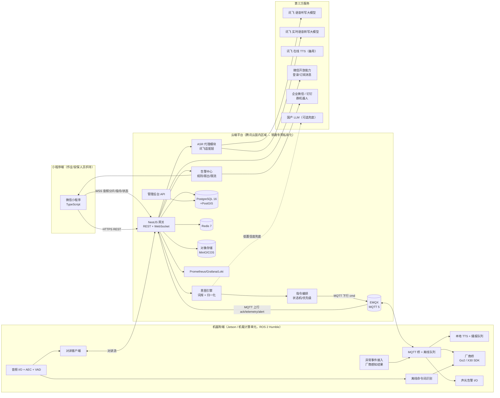
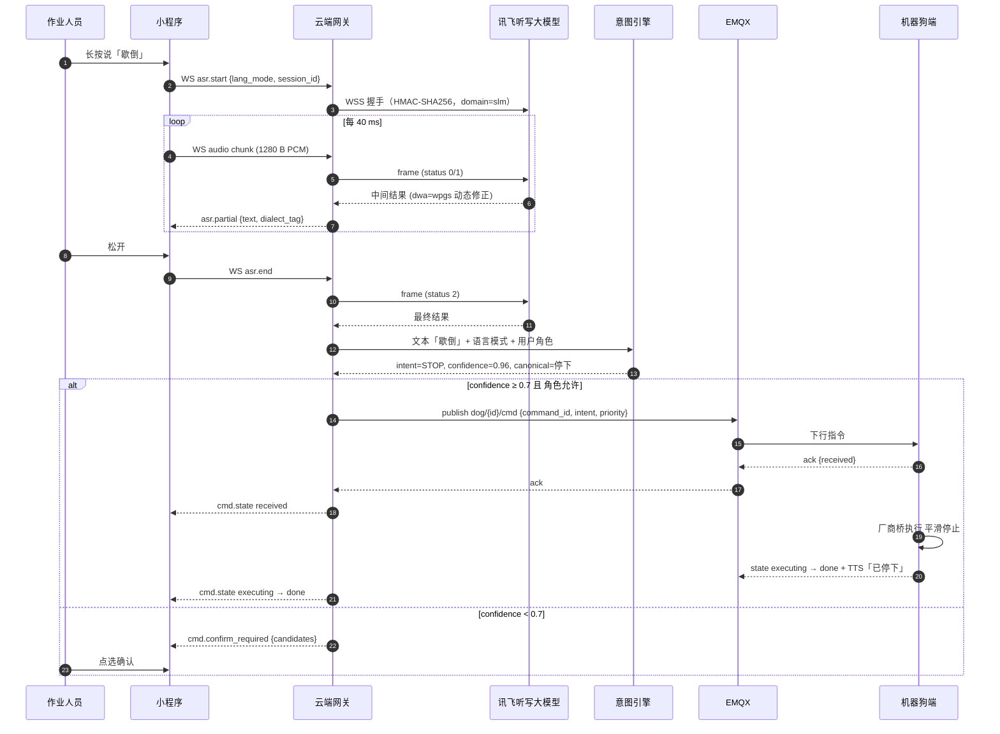
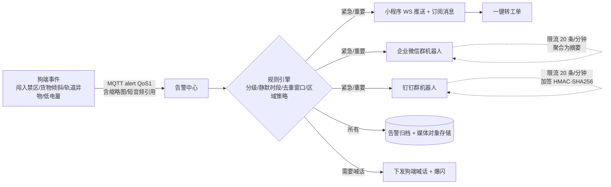

---

## 3. 系统架构

### 3.1 总体架构图

### 3.2 四个子系统与职责边界

| 子系统 | 职责（做什么） | 明确不做什么 |
|---|---|---|
| 小程序端 | 拾音并分片上传；显示识别文字与语种标签；语言切换；指令下发 UI 与三级回执；快捷按钮；状态面板；地图选点；告警接收与处置；PTT 对讲 UI；转工单入口 | 不直连讯飞；不做意图解析；不持有任何第三方密钥；不做离线 ASR |
| 云端平台 | 鉴权与 RBAC；ASR 代理（讯飞两套接口）；意图识别与置信度；指令编排、状态机、优先级、幂等；设备注册与遥测；告警规则与多通道扇出；录音留存与审计；词库/热词/语言模式/喊话库远程管理；管理后台 API；可观测性 | 不做机器人运动控制细节；不做音频 DSP（AEC/降噪在端侧） |
| 机器狗端 | 与云端 MQTT 会话；执行指令并上报状态；本地 TTS 与播报队列；外置麦克风阵列拾音 + AEC/降噪/VAD；离线核心命令词识别；对讲客户端；声光告警 I/O；厂商 SDK 封装；异常事件接入；健康上报；OTA | 不做在线 ASR（断网兜底除外）；不持有讯飞在线密钥；不做业务规则判断 |
| 管理后台 Web | 用户/角色/权限；站场/区域/巡检点/平面图；设备与固件；词库三元组与热词；喊话语句库；告警策略（分级、静默、循环）；指令日志与录音检索；告警归档与工单；讯飞密钥与配额监控 | 不承载实时控制（控制走小程序） |

### 3.3 关键链路 A：语音指令（端到端 ≤2 s）

**延迟预算（目标 ≤2000 ms，从松开按键到狗端开始应答）**

| 环节 | 预算 | 说明 |
|---|---|---|
| 小程序最后一帧上传 + 网关转发 | ≤150 ms | 4G/5G 单向 RTT 30～80 ms |
| 讯飞最终结果返回 | ≤400 ms | 需求书要求出字延迟 ≤300 ms；最终结果含尾部静音判定 |
| 意图引擎 | ≤20 ms | 纯内存词库匹配 |
| 权限校验 + 入库 + 发布 MQTT | ≤50 ms | Redis + 异步写库 |
| MQTT 到狗端（QoS 1） | ≤200 ms | 站内网络；弱网下重传 |
| 狗端接收 → 厂商桥下发 → 开始动作 | ≤300 ms | 停止类指令必须 ≤100 ms |
| 狗端 TTS 首音 | ≤500 ms | 预合成常用应答语缓存，命中则 ≤50 ms |
| 合计 | ≈1.6 s | 留 400 ms 余量给弱网 |

设计要点：

- 中间结果边听边显示（`asr.partial`），让用户感知延迟更低。
- 常用应答语（「收到，前往 A 点」「已停下」等）在狗端**预合成缓存**为音频文件，不走实时 TTS。
- 「停下/站住/莫动/歇倒/Stop/Halt」等急停词在网关做**前置关键词匹配**（意图引擎之前），命中即发高优先级指令，不等完整 NLP。

### 3.4 关键链路 B：双向对讲（≤1 s，30 分钟不中断）

**方案 C（基线，Phase 1～2 实现）：半双工 PTT 对讲，经云端网关中继**

- 小程序：PTT 按住 → `RecorderManager` PCM 16 kHz 分片 → WS 发送 `talk.audio`；松开 → `talk.end`。接收方向：WS 收到 `talk.audio` 分片 → `WebAudioContext` 调度 `AudioBufferSourceNode` 连续播放（抖动缓冲 120～200 ms）。
- 网关：按 `intercom_session` 转发；同时把音频复制一路送**讯飞实时转写大模型**（`lang=autodialect`，`audio_encode=pcm_s16le`，1280 B/40 ms）得到字幕；录音落对象存储（Opus 压缩）。
- 狗端：MQTT 不适合音频 → 狗端对讲客户端用 **WebSocket（或 gRPC 流）直连网关**；收到即经 AEC 参考信号送功放播放；狗端麦克风阵列（波束指向说话人）回传。
- 延迟估算：采集 40 ms + 上传 80 ms + 中继 10 ms + 下发 80 ms + 抖动缓冲 150 ms + 播放 40 ms ≈ 400 ms，满足 ≤1 s。
- 优点：不依赖微信类目资质；全链路可录音、可转写、可审计；实现成本低。
- 缺点：半双工（同一时刻一方说话），不是需求书字面的 WebRTC。

**方案 B（升级，Phase 2 评估/Phase 3 可选）：腾讯云 TRTC（或声网）全双工**

- 小程序侧用 `live-pusher`/`live-player`（`mode="RTC"`）承载 TRTC；需企业主体 + 特定类目 + 后台自助开通 ✅。
- 狗端用 TRTC 设备端 SDK（C 语言，Linux，CMake）⚠️（需向腾讯云确认 aarch64 构建与授权方式）。
- 字幕与录音通过 TRTC 云端录制/旁路推流再送讯飞转写。

**方案 A（备选）：微信「设备音视频通话」**

- `wx.requestDeviceVoIP`（基础库 2.27.3+）授权 → 设备侧通过微信硬件平台注册型号 + SN ✅；设备端能力依附 WMPF/VoIP 插件（Android 生态）⚠️，Jetson/Linux 侧集成路径不明确 → 仅当机器狗加装 Android 计算板时才考虑。

**决策 D-05**：Phase 1 做方案 C；Phase 0 用 T-004 验证主体类目能否开通 `live-pusher`/`live-player` 与 TRTC 设备端 SDK 的 aarch64 可用性；满足则 Phase 2 并行做方案 B，方案 C 保留为降级通道。

### 3.5 关键链路 C：告警（≤3 s 到达）

- 媒体（照片/短视频/语音原声）由狗端**先上传对象存储（预签名 URL）**，告警消息只带引用，保证 3 s 内到达。
- 群机器人 20 条/分钟限制 ✅（企业微信与钉钉均如此）：告警中心按群做令牌桶，超限时合并为一条「N 条告警摘要」。
- 告警分级：紧急（红）/重要（橙）/提示（黄）；分级规则可在后台配置。

### 3.6 关键链路 D：离线降级（股道间网络盲区）

| 情况 | 小程序端行为 | 云端行为 | 狗端行为 |
|---|---|---|---|
| 小程序断网、狗在线 | 显示「离线」；语音按钮禁用并提示；快捷按钮进入本地队列（仅非移动类，如查询），恢复后发送；急停按钮提示用户直接对狗喊话 | 用户 WS 心跳超时 → 标记离线 | 正常 |
| 狗断网、小程序在线 | 指令显示「待送达」，超时（默认 10 s）转「失败」并提示 | MQTT 会话保持（Session Expiry 300 s）；下行指令带 `expires_at`，过期不投递 | 进入「离线模式」：本地 KWS 监听核心命令词（停下/回巢/跟我走/开始巡检 + Stop/Return/Follow me/Start patrol）；执行后记录本地日志；联网后补传 |
| 双方都断网 | 同上 | — | 同上；低电量自动回巢策略仍生效 |
| 恢复联网 | 自动重连，拉取最新状态 | 对账：补传的离线指令写入日志并标注 `source=offline_kws` | 补传离线日志与遥测 |

离线 KWS 的实现方式与候选见 §4.3.4、D-12。

### 3.7 安全架构概览（详见 §11.1）

- **身份**：小程序 `wx.login` 换取 `openid` → 绑定企业人员账号（后台预先导入工号、角色、所属站段）；JWT（15 分钟）+ 刷新令牌（7 天）；管理后台独立账号 + 可选企业微信扫码。
- **授权**：RBAC 四级角色（普通人员 / 执勤人员 / 调度员 / 管理员）× 指令白名单（每条意图标注最低角色）；设备维度授权（用户只能控制被授权的狗）。
- **急停双通道**：云端前置关键词匹配 + 高优先级 MQTT 主题；狗端本地 KWS 独立于网络。
- **设备身份**：每台狗一张 X.509 客户端证书，EMQX 强制 mTLS；主题 ACL 限制只能发布/订阅自己的 `dog/{id}/#`。
- **数据**：敏感地理数据（平面图、股道、点位）SM4 应用层加密（密钥由 KMS/HSM 或私有化密钥服务托管）；录音加密存储；传输全程 TLS 1.3；私有化阶段内部链路可启用国密 TLS（RFC 8998 / TLCP，网关需支持铜锁 Tongsuo ⚠️）。
- **审计**：每条指令（谁、何时、原文、归一化结果、置信度、下发、回执）与每次对讲（参与者、时长、录音引用、转写）全部可检索、不可篡改（追加写 + 哈希链）。
- **密钥**：讯飞 AppID/APIKey/APISecret、群机器人 Webhook、LLM Key 只存于云端密钥管理（环境注入/KMS），后台只显示脱敏值与配额。
