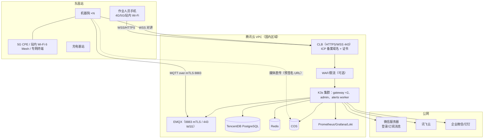

---

## 5. 部署环境

### 5.1 三类环境

| 环境 | 位置 | 形态 | 用途 | 数据 |
|---|---|---|---|---|
| DEV（开发/联调） | 开发者本机 + 一台腾讯云轻量/CVM（公网，供真机小程序联调） | Docker Compose 全栈 + mock 讯飞 + 虚拟狗 | 日常开发、CI、E2E | 合成数据 |
| PILOT（试点） | 腾讯云国内区域（广州/上海）或铁路局测试机房 | K3s 单集群（3 节点）或 2 台 CVM 的 Compose（最简） | 东昌站现场试点 | 真实数据（已分级，最小化） |
| PROD（生产） | 铁路局自建机房 / 铁路专网 | K3s 或 K8s（3 控制 + N 工作节点），Harbor 私有镜像仓库，离线安装 | 正式运行 | 真实数据，国密加密，不出境 |

原则：**同一套镜像、同一套 Helm Chart/Compose 文件，只换 values**。所有外部依赖（PostgreSQL、Redis、EMQX、对象存储）在 PILOT 可用云托管版，在 PROD 用容器自托管版，应用代码零改动。

### 5.2 网络拓扑（PILOT 示例）



端口与协议：对外仅开放 443（HTTPS/WSS）与 8883（MQTT/TLS）；运维入口走堡垒机 + VPN；EMQX Dashboard、Grafana 只在内网。

PROD 差异：CLB 换为专网负载均衡/硬件 F5；对象存储换 MinIO；讯飞接口经**专网出口白名单**访问公有云节点，或采用讯飞私有化部署（需求书 R-10.1 列为可选）；内部链路可启用国密 TLS（RFC 8998 / TLCP）⚠️ 需网关与客户端均支持（铜锁 Tongsuo 生态）；EMQX 国密支持需在 Phase 0 验证（T-012），不支持则在应用层做 SM4 载荷加密。

### 5.3 容器与编排

- 镜像：`gateway`、`admin-web`（Nginx 静态）、`alerts-worker`（BullMQ 消费者，可与 gateway 同镜像不同入口）、`mock-xfyun`（仅 DEV/CI）、`dog-sim`（仅 DEV/CI）；边缘：`dog-core`（ROS 2 节点集）、`dog-audio`、`dog-ota`。
- 多架构构建：`docker buildx --platform linux/amd64,linux/arm64`；边缘镜像基于 `ros:humble-ros-base`（arm64）或 NVIDIA L4T 基础镜像。
- Helm Chart：`infra/helm/railvoice/`，values 分 `dev/pilot/prod`；Secrets 通过 External Secrets Operator 或 Sealed Secrets 注入。
- Compose：`infra/compose/docker-compose.yml`（DEV 全栈）、`infra/compose/pilot-minimal.yml`（2 台机器最简试点）。
- 数据库迁移：`prisma migrate deploy` 作为 Job/InitContainer，失败阻断发布。
- 零停机：gateway 无状态；WS 连接断开后小程序自动重连并恢复会话（`session_id` 保存在 Redis）。

### 5.4 机器狗端部署与 OTA

1. 出厂镜像：JetPack 6 + Docker + `docker compose` + `ota-agent` + 设备证书（出厂时由云端签发并写入安全存储）。
2. 配置：设备启动后用证书连 EMQX，订阅 `dog/{id}/config`，拉取站场配置（词表、喊话库、策略、MQTT/对讲端点）。
3. OTA：云端发布签名的 `compose.manifest.json`（镜像摘要列表 + 版本 + 签名）；`ota-agent` 校验 Ed25519 签名 → 预拉取镜像 → 在「充电中 + 空闲」窗口切换 → 健康检查失败自动回滚到上一版本。
4. 日志：本地 journald + 滚动文件；联网时经 MQTT `dog/{id}/log` 分级上传，或由 `promtail` 推 Loki。
5. 时钟：chrony 指向云端/站内 NTP。

### 5.5 CI/CD 流水线

```
PR 打开 → lint + typecheck + 单元测试（web/gateway/edge）→ 集成测试（Testcontainers：PG/Redis/EMQX + mock-xfyun + dog-sim）
      → 构建镜像（amd64 + arm64）→ Trivy 漏洞扫描（高危阻断）→ 生成 SBOM
      → 合并到 main → 推送镜像到仓库（GHCR/腾讯云 TCR/Harbor）→ 部署 DEV（自动）
      → 打 tag vX.Y.Z → 部署 PILOT（需人工批准）→ 冒烟测试（k6 + E2E）→ 边缘 OTA 清单签名发布（灰度 1 台 → 全部）
小程序：PR → 构建 → miniprogram-ci 上传「开发版」；tag → 上传「体验版」→ 人工提审 → 发布
```

工具：GitHub Actions（或 Gitee Go / Jenkins 私有化）；私有化环境用 Argo CD 做 GitOps 拉取式部署，避免 CI 直连生产。

### 5.6 可观测性、备份与容量

| 项 | 方案 |
|---|---|
| 指标 | Prometheus 采集 gateway（请求/WS 连接数/ASR 会话数/讯飞并发占用/意图置信度分布/指令端到端延迟直方图）、EMQX、PostgreSQL、节点；狗端经 MQTT 上报后由 gateway 暴露 |
| 日志 | Loki；结构化 JSON；敏感字段脱敏 |
| 追踪 | OpenTelemetry：一条 `command_id` 从 `asr.start` 到 `cmd.done` 全链路 span，用于验收 KPI-06 |
| 告警 | Alertmanager → 企业微信（运维群，与业务告警分开） |
| 备份 | PostgreSQL 每日全量 + WAL 连续归档（保留 30 天）；对象存储版本化 + 跨可用区；配置与词库版本在 Git |
| 容量（试点） | gateway 2 副本 × 2 vCPU/4 GB；PostgreSQL 4 vCPU/16 GB/500 GB；Redis 2 GB；EMQX 2 vCPU/4 GB；对象存储按录音量（见 §11.2） |
| SLO | 网关可用性 99.9%（试点）；指令端到端 P95 ≤2 s；告警到达 P95 ≤3 s |
