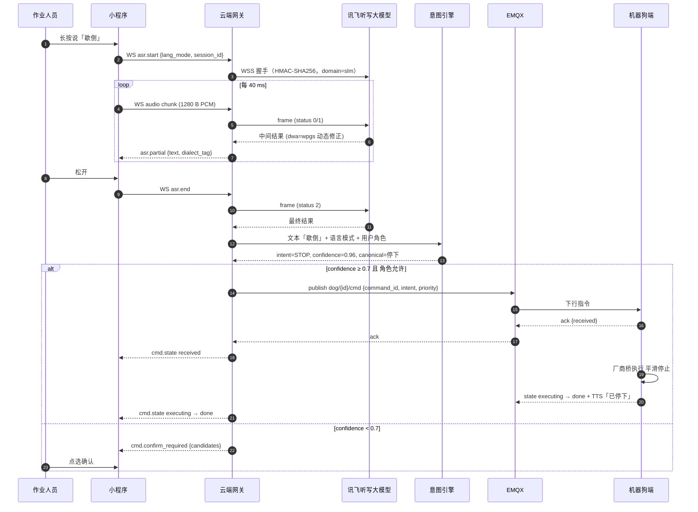
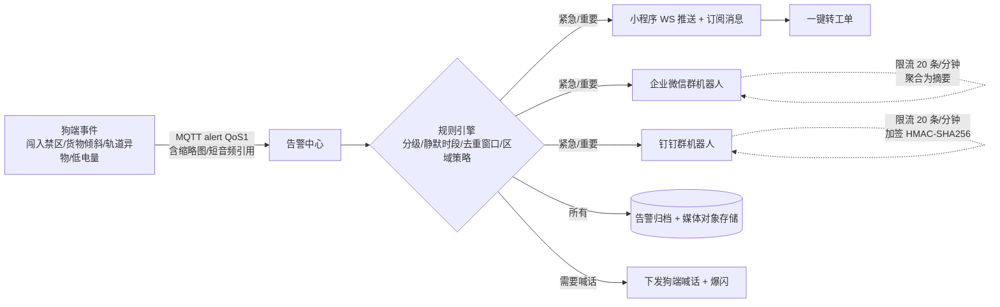
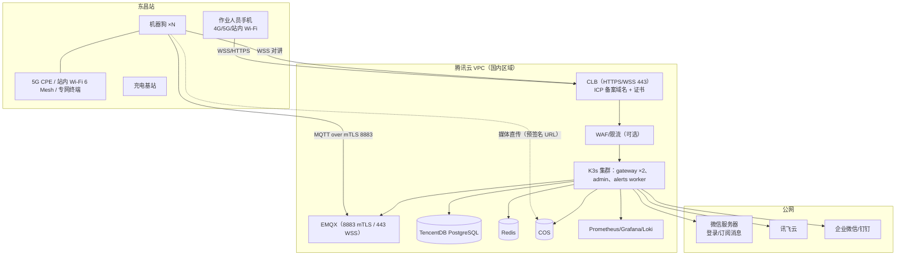
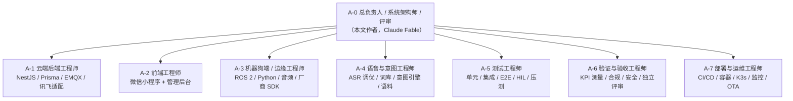

# 铁路站场人机语音互动系统 — 技术分析与实施策划书

| 项目 | 内容 |
|---|---|
| 文档版本 | v1.0（首版，可派发执行） |
| 编制日期 | 2026-10-23 |
| 编制人 | 项目总负责人 / 系统架构师 / 主开发（AI Agent「帮徐老师写Proposal」，Paperclip 任务 DOU-3） |
| 依据文件 | 《铁路站场人机语音互动系统开发需求说明书》V4（国内站场版，编制日期 2026-10-19，8 页，以下简称「需求书」） |
| 目标读者 | 业主（徐老师）、项目组成员、被派发任务的 AI 模型（Claude Sonnet / Opus、Codex 等）与各专职 Agent |
| 文档状态 | 待业主确认（见 §12.1 需要您决定的事项） |


## 目录

- 0. 文档使用说明（请先读）
  - 0.1 本文档是什么
  - 0.2 编号与约定
  - 0.3 派发给其他模型时的规则
- 1. 执行摘要
  - 1.1 一句话概括
  - 1.2 技术栈总览
  - 1.3 十二项架构决策（详见各章）
  - 1.4 需求书与技术现实的关键差异（必须先知道）
  - 1.5 三大风险（完整风险登记册见 §11.3）
  - 1.6 建议时间线（需求书周期「待确认」，以下为建议值）
- 2. 需求分析
  - 2.1 需求书结构与本文映射
  - 2.2 功能需求清单（可追踪）
  - 2.3 隐含需求与技术约束（需求书未写明但必须满足）
  - 2.4 需求书「待确认项」的处理建议（Q-01 ～ Q-08）
  - 2.5 范围外（本期不做，但预留接口）
- 3. 系统架构
  - 3.1 总体架构图
  - 3.2 四个子系统与职责边界
  - 3.3 关键链路 A：语音指令（端到端 ≤2 s）
  - 3.4 关键链路 B：双向对讲（≤1 s，30 分钟不中断）
  - 3.5 关键链路 C：告警（≤3 s 到达）
  - 3.6 关键链路 D：离线降级（股道间网络盲区）
  - 3.7 安全架构概览（详见 §11.1）
- 4. 技术栈详解
  - 4.1 前端
  - 4.2 云端
  - 4.3 机器狗端（边缘）
  - 4.4 第三方服务与 API（含「您需要做什么」）
  - 4.5 开发环境与工具链
- 5. 部署环境
  - 5.1 三类环境
  - 5.2 网络拓扑（PILOT 示例）
  - 5.3 容器与编排
  - 5.4 机器狗端部署与 OTA
  - 5.5 CI/CD 流水线
  - 5.6 可观测性、备份与容量
- 6. 数据模型与协议规格
  - 6.1 核心数据模型（PostgreSQL，Prisma schema 以此为准）
  - 6.2 小程序 ↔ 云端 WebSocket 协议（单连接多路复用）
  - 6.3 云端 ↔ 机器狗 MQTT 主题与载荷
  - 6.4 REST API（管理后台与小程序非实时操作，节选）
- 7. 语音识别与意图识别设计
  - 7.1 语言模式与讯飞接口映射
  - 7.2 ASR 适配层（`apps/gateway/src/asr`）
  - 7.3 词库与归一化（`packages/lexicon`）
  - 7.4 词库管理流程
  - 7.5 测试语料与准确率评估（为 KPI-01～03 服务）
  - 7.6 TTS 与播报策略（狗端）
- 8. 实施路线图与任务卡
  - 8.1 代码仓库结构（Phase 0 建立）
  - 8.2 阶段与里程碑
  - 8.3 任务卡（可直接派发）
  - 8.4 关键路径与并行度
- 9. Agent 团队设计（开发 / 测试 / 验证 / 部署）
  - 9.1 组织结构
  - 9.2 通用工作规则（所有 Agent）
  - 9.3 Agent 简报（可直接作为系统提示词派发）
  - 9.4 通用完成定义（DoD）
  - 9.5 「决策变更申请」模板
  - 9.6 任务派发卡模板（Paperclip 子任务描述）
- 10. 测试与验证策略
  - 10.1 测试金字塔与责任
  - 10.2 关键专项测试
  - 10.3 KPI 测量方法（对应需求书第九章）
  - 10.4 缺陷管理
- 11. 合规与安全、成本与配额、风险登记册
  - 11.1 合规与安全实施清单
  - 11.2 成本与配额估算（试点规模；均为估算，需按报价校准）
  - 11.3 风险登记册
- 12. 业主行动清单与附录
  - 12.1 您需要做的事（按紧急程度）
  - 12.2 附录 A：需求追踪矩阵（初版，由 A-6 维护）
  - 12.3 附录 B：术语表
  - 12.4 附录 C：参考资料（核验来源）
  - 12.5 附录 D：词库种子（摘自需求书第七章，JSON 版见 `docs/seed/command-lexicon.v1.json`）
  - 12.6 附录 E：消息示例

---

## 0. 文档使用说明（请先读）

### 0.1 本文档是什么

本文档是对需求书的**完整技术分析**与**可执行的实施策划**。它回答四个问题：

1. 这个系统由哪几块组成，每块用什么语言、框架、开发环境、数据库和云服务（§3、§4、§5）。
2. 需求书里哪些要求可以直接做、哪些与技术现实有出入、哪些必须先做决策（§2）。
3. 具体怎么做：数据模型、协议、语音链路设计、分阶段路线图、可直接派发的任务卡（§6、§7、§8）。
4. 由哪些 Agent 来开发、测试、验证、部署，每个 Agent 的职责边界、输入输出和提示词（§9、§10）。

### 0.2 编号与约定

| 前缀 | 含义 | 示例 |
|---|---|---|
| `R-x.y` | 需求书章节编号（第 x 章 y 节） | `R-4.6` = 需求书「4.6 离线降级」 |
| `D-nn` | 本文的架构/技术决策 | `D-03` |
| `Q-nn` | 待业主确认的问题 | `Q-01` |
| `RK-nn` | 风险条目 | `RK-05` |
| `T-nnn` | 可派发任务卡 | `T-101` |
| `KPI-nn` | 验收指标（对应需求书第九章） | `KPI-07` |
| `A-n` | Agent 编号 | `A-3` |

规范用语：**MUST**（必须）、**SHOULD**（应当）、**MAY**（可以）。

事实核验标记（本文所有外部技术事实均按此标注）：

- ✅ 已对照官方文档核验（2026-10-23）。
- ⚠️ 未能从官方一手资料核验，需在 Phase 0 验证（已列入任务卡）。
- ❗ 与需求书内容不一致，需求书需修订或由业主决策。

### 0.3 派发给其他模型时的规则

1. 每个被派发的模型 MUST 先读 §0、§1、§2.3、§3，再读自己的 Agent 简报（§9）和分配的任务卡（§8），最后按需读 §6/§7/§12 的协议与附录。
2. 被派发的模型 MUST NOT 自行更改 D-01～D-12 架构决策。发现决策与事实冲突时，停止相关工作，向总负责人（A-0）提交「决策变更申请」（模板见 §9.5），由总负责人裁决。
3. 任何对外部服务（讯飞、微信、云厂商、IM 群机器人、LLM）的接入 MUST 使用 §4.4 列出的接口与参数，并先在本地用 mock 跑通，再接真实密钥。密钥 MUST NOT 出现在代码、日志、文档或任务评论中。
4. 任何需要业主操作的事项（注册、付费、审核、采购、签合同）MUST 汇总成「业主行动项」提交，而不是在代码里绕过。
5. 完成定义（DoD）以任务卡为准；没有测试和验证记录的工作不算完成。

---

## 1. 执行摘要

### 1.1 一句话概括

为国内铁路站场研制「**微信小程序（耳朵+嘴替）＋ 四足机器狗（腿+喇叭）＋ 云端平台（大脑+账本）**」的双向语音互动系统：作业人员用中文/方言/英语对小程序说话 → 云端经讯飞 ASR 转文字 → 意图引擎归一为指令 → 下发机器狗执行并 TTS 应答；机器狗发现异常 → 声光告警 + 推送到小程序和企业微信/钉钉群；股道间断网时，机器狗本地仍能识别「停下、回巢、跟我走、开始巡检」等核心指令。

### 1.2 技术栈总览

| 层 | 选型 | 语言 | 关键框架/组件 | 决策编号 |
|---|---|---|---|---|
| 小程序端 | 微信小程序（原生框架） | TypeScript | 原生小程序 + TDesign Miniprogram 组件库 + MobX 状态管理；`RecorderManager`（PCM 16 kHz 流式录音）、`wx.connectSocket`（WSS）、`WebAudioContext`（PCM 低延迟播放）、`map` 组件 + 自定义站场平面图 | D-01, D-05 |
| 管理后台 Web | 单页应用 | TypeScript | React 18 + Ant Design 5 + Vite | D-01 |
| 云端网关/业务 | 单体服务（模块化，可拆分） | TypeScript（Node.js 24 LTS） | NestJS 11（REST + WebSocket 网关）、Prisma ORM、zod 协议校验、BullMQ 任务队列 | D-02 |
| 消息总线（设备侧） | MQTT 5 | — | EMQX 5（开源版，自托管；设备 mTLS 接入；QoS 1；离线消息） | D-02 |
| 数据库 | 关系型 + 缓存 + 对象存储 | SQL | PostgreSQL 16 + PostGIS（位置）+ 分区表（遥测）；Redis 7（会话、指令状态、限流、Pub/Sub）；S3 兼容对象存储（MinIO 自托管 / 腾讯云 COS）存录音、照片、短视频 | D-06 |
| 语音识别 | 科大讯飞（需求书指定） | — | 语音听写大模型（中英，`domain=slm`，202 种方言免切换）用于 ≤60 s 指令；实时语音转写大模型（`lang=autodialect`）用于对讲长音频；离线命令词 SDK / 开源 KWS 用于断网兜底 | D-07 |
| 意图识别 | 自研确定性引擎 + 可选 LLM 兜底 | TypeScript | 词库三元组（主指令 / 方言别名 / 英文等价）→ 规范化 → 精确/别名/拼音模糊匹配 → 置信度；LLM 兜底仅在低置信度且用户确认下使用 | D-08 |
| 机器狗端（边缘） | Ubuntu 22.04 + ROS 2 Humble | Python 3.10（C++ 按需） | rclpy 节点：音频 I/O、AEC/降噪、VAD、离线 KWS、TTS、对讲、MQTT 桥、厂商桥（宇树 Go2 / 云深处 X30）、声光告警 I/O、遥测、OTA | D-03, D-04 |
| 双向对讲 | 分两步走 | — | 基线：自建半双工 PTT 对讲（WebSocket + Opus/PCM + WebAudio 播放，不依赖微信特殊类目）；升级：腾讯云 TRTC / 微信设备通话（需类目与资质，Phase 0 验证） | D-05 |
| 告警推送 | 多通道 | — | 小程序 WS 实时推送 + 微信订阅消息；企业微信群机器人 Webhook；钉钉自定义机器人 Webhook（均 20 条/分钟限流，需聚合） | D-09 |
| 部署 | 容器化 | — | Docker；开发用 Docker Compose；试点用 K3s（腾讯云国内区域或铁路局机房）；生产用铁路专网私有化 K3s/K8s + Harbor 离线镜像；边缘用 Docker Compose + 签名镜像 OTA | D-10 |
| CI/CD | GitHub Actions 或 Gitee Go（国内） | — | lint → 单测 → 集成测试 → 构建镜像 → Trivy 扫描 → 推送 → 部署；小程序用 `miniprogram-ci` 上传体验版 | D-10 |
| 可观测性 | 开源栈 | — | Prometheus + Grafana + Loki + Alertmanager；OpenTelemetry 链路追踪（追踪一条语音指令的端到端耗时） | D-10 |
| 安全 | 分级 | — | JWT + RBAC（普通人员/执勤/调度/管理员）、指令白名单、急停最高优先级、设备 mTLS、国密 SM4 应用层加密敏感数据、录音留存与审计 | D-11 |

### 1.3 十二项架构决策（详见各章）

| 编号 | 决策 | 一句话理由 |
|---|---|---|
| D-01 | 前端全部 TypeScript；小程序用原生框架而非 Taro/uni-app | 录音、WebSocket、WebAudio 等底层 API 直接可控；减少跨端框架带来的音频坑 |
| D-02 | 云端用 NestJS 单体（模块化）+ EMQX，而非微服务 | 试点规模（单站、≤10 台狗、≤200 用户）下单体最省；模块边界清晰，后续可拆 |
| D-03 | 机器狗端用 ROS 2 Humble + Python，厂商 SDK 封装在「厂商桥」节点后面 | 需求书要求「预留 ROS 2 接口、不绑死单一厂商」 |
| D-04 | 机器狗音频不依赖本体内置扬声器/麦克风，加装外置麦克风阵列 + 大功率喊话器 | 宇树 Go2 内置音频无官方 SDK 入口 ⚠️；100 dB 可辨的要求本身就需要外置喊话器 |
| D-05 | 双向对讲先做「半双工 PTT（WebSocket）」基线，再评估 TRTC/微信设备通话 | 小程序实时音视频组件受类目与资质限制 ✅，不能让核心功能押在审批上 |
| D-06 | PostgreSQL 为唯一事实源；遥测走分区表；录音/媒体走对象存储 | 单一数据库简化合规审计与备份；对象存储便于留存策略 |
| D-07 | ASR 走「后端代理」模式，讯飞密钥只在云端 | 需求书 R-4.3 明确要求；也便于计费与限流 |
| D-08 | 意图识别「确定性优先」，LLM 仅兜底且默认关闭 | 安全指令必须可预测、可审计；方言口语靠词库而非靠模型「猜」 |
| D-09 | 告警为事件流：规则引擎 → 多通道扇出 → 限流聚合 → 工单 | 群机器人 20 条/分钟硬限制；夜间静默等策略需集中管理 |
| D-10 | 一套容器镜像跑通「开发 → 试点公有云 → 生产专网私有化」 | 需求书 R-10.1 要求不出境、可自建机房；私有化是终局 |
| D-11 | 安全按「最小权限 + 指令白名单 + 急停双通道」设计 | 急停必须在云端和狗端各有一条独立可用通道 |
| D-12 | 离线核心指令在**机器狗端**识别，而不是小程序端 | 微信小程序无法内嵌讯飞离线 SDK ❗（见 §2.3） |

### 1.4 需求书与技术现实的关键差异（必须先知道）

| # | 需求书原文要点 | 技术现实（核验结果） | 处理方式 |
|---|---|---|---|
| 1 | R-4.6「引入讯飞离线命令词识别 SDK，断网时识别核心指令」，并写在小程序章节语境下 | 微信小程序不能加载原生 SDK，也没有离线 ASR 能力 ❗ | 离线识别放到机器狗端（麦克风阵列直接听人说话）；小程序端断网时只保留「快捷按钮 + 本地队列」（D-12） |
| 2 | R-4.2/4.3 参数 `accent=mulacc`、`domain=slm`/`iat`、`ptt`、`nunum`、`nbest/wbest` | 讯飞「语音听写大模型（中英）」官方文档：`domain=slm`、`language=zh_cn`、`accent=mandarin`（固定值），202 种方言自动判别无需参数；中英过滤用 `ltc`；`dwa=wpgs` 动态修正；`dhw` 会话热词 ✅。`mulacc/ptt/nunum/nbest` 属于旧版听写 API（`iat-api.xfyun.cn/v2/iat`）❗ | 适配层按新版大模型 API 实现；旧版参数不再使用；英语模式用多语种大模型接口或 `ltc=3`（Phase 0 验证） |
| 3 | R-4.1「实时语音转写大模型」 | 官方端点为 `wss://office-api-ast-dx.iflyaisol.com/ast/communicate/v1`，`lang=autodialect`（中英+202 方言），HMAC-SHA1 签名，8 小时上限，15 s 无音频断连 ✅ | 对讲转写按此实现；注意它与听写接口是两套鉴权体系 |
| 4 | R-6.1「本地 TTS 播报」、R-6.2「狗端扬声器不被自身麦克风拾回」 | 宇树 Go2 内置扬声器/麦克风无官方 SDK 访问路径 ⚠️；G1 有 `AudioClient`，Go2 社区只能走非官方 WebRTC | 外置麦克风阵列（带硬件 AEC）+ 外置功放喊话器，由机载计算单元驱动（D-04） |
| 5 | R-6.4 本体 IP54 以上、-20～55 ℃、续航 3～5 h | 云深处 X30：IP67、-20～55 ℃、约 2.5～4 h ✅（经销商资料）；宇树 Go2 EDU：Jetson Orin NX 机载，续航 2～4 h，官方未公布 IP 等级 ⚠️ | 原型用 Go2 EDU（便宜、SDK 成熟）；试点/生产用 X30 级工业平台（Q-04） |
| 6 | R-8「音频传输：WebRTC 做双向对讲」 | 小程序 `live-pusher`/`live-player`（TRTC 载体）仅对企业主体、特定类目开放，需后台自助开通 ✅；微信「设备音视频通话」`wx.requestDeviceVoIP` 需基础库 2.27.3+、微信硬件平台注册设备型号 ✅，设备端依赖 WMPF（Android）⚠️ | 基线用自建半双工 PTT；WebRTC 方案作为 Phase 2 升级项，Phase 0 先确认类目资格（D-05） |
| 7 | R-10.1 引用《交通运输数据安全管理办法》（交科技规〔2026〕3 号） | 交通运输部 2026-06-18 印发，数据分为核心/重要/一般（一般再分 1～3 级）✅ | 项目启动即做数据分类分级（T-010） |

### 1.5 三大风险（完整风险登记册见 §11.3）

1. **RK-01 对讲通道资质**：微信实时音视频能力受类目限制，若主体/类目不符，WebRTC 方案无法上线。缓解：D-05 基线方案不依赖资质。
2. **RK-02 机器狗硬件与现场网络**：试点站（东昌站）无线覆盖、专网接入、机器狗平台选型都未定，直接决定离线策略和对讲延迟。缓解：Phase 0 现场勘测 + 硬件抽象层。
3. **RK-03 方言识别准确率验收**：需求书要求主流方言 ≥95%，但站场噪声、方言分布未知，且方言大模型为独立购买产品。缓解：Phase 0 采集站场真实语料建立测试集，按数据而非按感觉调优；商务上提前锁定讯飞多语种套餐。

### 1.6 建议时间线（需求书周期「待确认」，以下为建议值）

| 阶段 | 建议周期 | 出口标准（摘要） |
|---|---|---|
| Phase 0 准备与验证 | 2 周 | 账号/资质/密钥到位；对讲与离线方案 spike 结论；硬件下单；数据分级完成 |
| Phase 1 原型闭环 | 6 周 | 小程序中文/方言语音 → 讯飞 ASR → 意图 → 狗端应答 + 移动，端到端 ≤2 s（实验室） |
| Phase 2 功能迭代 | 8 周 | 语言切换、半双工对讲、告警推送、词库热更新、离线核心指令、弱网策略、管理后台 |
| Phase 3 现场试点 | 6 周 | 东昌站实测；方言测试集准确率达标；安全规范联调；录音留存与审计可查 |
| Phase 4 验收交付 | 4 周 | 稳定版 + 文档 + 运维手册 + 培训；KPI 全部有测量记录 |

总计约 26 周。各阶段详细 WBS 与任务卡见 §8。


---

## 2. 需求分析

### 2.1 需求书结构与本文映射

| 需求书章节 | 要点 | 本文落点 |
|---|---|---|
| 一、项目背景与目标 | 轻端（小程序）+ 重体（机器狗）；双向语音通道 | §1、§3.1 |
| 二、角色定义 | 小程序 = 麦克风+显示屏；机器狗 = 喇叭+执行体 | §3.2 |
| 三、应用场景（试点：东昌站） | 货场巡检 / 站区治安巡控 / 设备间巡视 | §2.4 Q-01、§8 Phase 3 |
| 四、ASR 需求（讯飞） | 选型、语言策略、接口规格、兜底、性能、离线降级 | §4.4.1、§7 |
| 五、小程序端需求 | 语音交互、指令下发与显示、告警接收 | §4.1、§6.3 |
| 六、机器狗本体需求 | TTS 应答、双向对讲、声光告警、本体性能 | §4.3、§3.4 |
| 七、指令词库与交互剧本 | 控制类/查询类/告警类/喊话类/词库管理 | §7.3、附录 D 词库种子 |
| 八、技术架构 | 通信链路、音频传输、语音处理链路、延迟、底座、云端、安全 | §3 |
| 九、性能指标（验收标准） | 10 项 KPI | §10.3 KPI 测量方法 |
| 十、合规与风险 | 数据安全、无线通信与作业安全、讯飞配额与成本 | §11 |
| 十一、交付与里程碑 | 四阶段，周期待确认 | §8 |
| 十二、待确认/补充项 | 8 项 | §2.4 |

### 2.2 功能需求清单（可追踪）

下表把需求书拆成可验证的功能需求，供任务卡与测试用例引用。

| 需求 ID | 来源 | 需求描述（可验证形式） | 优先级 | 承载子系统 |
|---|---|---|---|---|
| FR-01 | R-5.1 | 长按/唤醒词开始拾音，松开发送；录音以 16 kHz/16 bit/单声道 PCM 分片流式上传 | P0 | 小程序 |
| FR-02 | R-4.2, R-5.1 | 常驻语言按钮：中文·方言自动 / 普通话 / 英语 / 中英混说；切换 ≤1 s 生效并持久化到用户偏好；联动词库与 TTS 语音包 | P0 | 小程序、云端 |
| FR-03 | R-5.1 | 识别文字实时回显 + 语种/方言标签；保留口语原貌，确认后归一化 | P0 | 小程序、云端 |
| FR-04 | R-4.4, R-5.1 | 文字兜底：手动改字或直接输入文字指令 | P0 | 小程序 |
| FR-05 | R-4.4 | 意图置信度 <0.7 时弹回用户确认；方言口语映射到统一意图 | P0 | 云端 |
| FR-06 | R-5.2 | 指令三级回执：收到 → 执行中 → 完成（含失败/取消） | P0 | 全链路 |
| FR-07 | R-5.2 | 快捷指令按钮（语音之外的兜底） | P0 | 小程序 |
| FR-08 | R-5.2 | 实时显示电量、位置、姿态、当前任务、在线状态、信号强度 | P0 | 小程序、狗端 |
| FR-09 | R-5.2 | 站场平面图选点 + 语音确认，下发「去 X 点」 | P1 | 小程序、云端 |
| FR-10 | R-5.3, R-7.3 | 告警实时推送到小程序，并同步到企业微信群/钉钉群；三级分级（红/橙/黄） | P0 | 云端 |
| FR-11 | R-5.3 | 告警内容含事件类型、股道/位置坐标、现场照片或短视频、语音原声 | P0 | 狗端、云端、小程序 |
| FR-12 | R-5.3 | 一键转工单，关联作业计划与责任人 | P1 | 云端、小程序、后台 |
| FR-13 | R-6.1 | 狗端本地 TTS 播报云端下发文本；语音包随语言模式联动；中英两套喊话语句库可远程自定义 | P0 | 狗端、后台 |
| FR-14 | R-6.1 | 播报防抖与排队，同事件不重复喊；100 dB 环境可辨 | P0 | 狗端 |
| FR-15 | R-6.2 | 双向对讲：小程序说话 → 机载喇叭；机载麦克风 → 小程序；端到端 ≤1 s；持续 30 分钟不中断；对讲音频流经实时转写接口转文字 | P0 | 全链路 |
| FR-16 | R-6.2 | 回声抑制：狗端播报声不被自身麦克风拾回 | P0 | 狗端 |
| FR-17 | R-6.3 | 爆闪灯 + 高分贝喊话器；自动触发（闯入禁区/设备异常/货物倾斜）+ 远程手动触发 | P0 | 狗端、云端 |
| FR-18 | R-6.3 | 告警区域与时间策略可配（夜间静默、禁区循环播报） | P1 | 后台、云端 |
| FR-19 | R-7.1~7.4 | 控制类 7 条、查询类 4 条、告警类 4 条、喊话类 3 条交互剧本全部可用 | P0 | 全链路 |
| FR-20 | R-7.5 | 词库以「中文主指令 + 方言口语别名 + 英文等价词」三元组管理，支持远程热更新；站区人员可录入补充方言 | P0 | 后台、云端 |
| FR-21 | R-4.2, R-7.5 | 铁路术语热词上传讯飞（控制台 `res_id` 应用级 + 会话级 `dhw`） | P0 | 云端 |
| FR-22 | R-4.6 | 断网时核心指令（停下、回巢、跟我走、开始巡检 + 英语等价）仍可响应 | P0 | 狗端 |
| FR-23 | R-8 | 指令白名单 + 权限分级：普通人员仅查询；调度/执勤可执行移动指令；急停最高优先级永远即时响应 | P0 | 云端、狗端 |
| FR-24 | R-8 | 云端：账户体系、设备管理、指令日志、告警归档、讯飞密钥管理、语言模式与词库远程更新 | P0 | 云端、后台 |
| FR-25 | R-10.2 | 语音通信录音留存（指令音频 + 对讲音频），可按时间/人员/设备检索，用于责任追溯 | P0 | 云端 |
| FR-26 | R-10.1 | 站场布局、股道走向、设备点位等敏感数据国密加密存储，权限分级访问 | P0 | 云端 |
| FR-27 | R-10.2 | 拾音/录像提示标识；涉及旅客肖像与声音的数据按《个人信息保护法》处理（最小化、脱敏、留存期限） | P1 | 产品/合规 |
| FR-28 | R-10.3 | 小程序录音分段 + 限流，静音不发包；并发路数监控与告警 | P0 | 小程序、云端 |

### 2.3 隐含需求与技术约束（需求书未写明但必须满足）

1. **微信小程序平台约束**（✅ 微信官方规则）
   - 服务器域名必须是已 **ICP 备案** 的域名，使用可信 CA 签发的证书，`wss://` 需在小程序后台「服务器域名 → socket 合法域名」登记；小程序不能直连 IP。
   - 同时最多保持 5 个 WebSocket 连接；录音需用户授权 `scope.record`；后台运行时录音会中断（`onInterruptionBegin`）。
   - `RecorderManager.start` 支持 `format: 'PCM'`、`sampleRate: 16000`、`numberOfChannels: 1`、`frameSize`（KB）分片回调 `onFrameRecorded`（仅 mp3/pcm 支持分片）；单次录音上限 10 分钟。
   - 实时音视频组件（`live-pusher`/`live-player`）仅企业主体、特定类目可自助开通；个人主体与测试号不可用；开发者工具不渲染，只能真机调试。
   - 不能内嵌原生 SDK → 没有离线 ASR；断网时只能做 UI 层兜底。
2. **管理后台是刚需**：需求书 R-8「云端」列出的账户、设备、日志、归档、密钥、词库远程更新都需要操作界面，必须有一个 Web 管理后台（本文纳入范围，见 §4.1.2）。
3. **机器狗需要机载计算单元**：音频处理、离线 KWS、TTS、MQTT 客户端、厂商 SDK 都要跑在狗身上。Go2 EDU 自带 Jetson Orin NX；X30 需确认扩展计算单元（Q-04）。
4. **外置音频硬件**：麦克风阵列（带硬件 AEC/波束成形）、功放 + 号角喇叭（≥100 dB@1 m）、爆闪灯继电器 — 这是「硬件 BOM」，需采购（§12.1）。
5. **时钟同步**：讯飞鉴权允许 ±300 s 时钟偏差 ✅；指令日志与录音需要可信时间戳 → 所有节点 NTP/chrony 同步。
6. **音频留存的存储量**：16 kHz/16 bit PCM 约 1.9 MB/分钟；对讲 30 分钟 ≈ 57 MB；需压缩（Opus 约 24 kbps ≈ 0.18 MB/分钟）与留存策略。
7. **弱网与断网下的状态一致性**：指令状态机必须幂等（重复下发同一 `commandId` 不会重复执行），狗端离线队列必须有过期时间（过期的「去 A 点」不能在恢复联网后突然执行）。

### 2.4 需求书「待确认项」的处理建议（Q-01 ～ Q-08）

下表给出**本文采用的默认假设**。业主确认或推翻任一项，均在 §12.1 勾选。

| 编号 | 需求书待确认项 | 本文默认假设 | 影响范围 |
|---|---|---|---|
| Q-01 | 试点站场选择（编组站货场 / 客运站候车区 / 车辆段检修区） | 需求书第三章已写「试点站：东昌站」且场景以货场巡检为首 → 默认 **货场巡检** 为首发场景，候车区喊话为次 | 词库优先级、告警类型、作业安全规范 |
| Q-02 | 对接单位（国铁集团局/站段 vs 铁路公安派出所） | 默认 **站段（运维巡检为主）**，治安巡控功能保留但降为 P1 | 权限模型、告警推送对象、工单系统对接 |
| Q-03 | 小程序形态（微信小程序 vs 独立 App） | 采纳需求书建议：**微信小程序**；但离线核心指令由狗端承担（D-12） | 整个前端技术栈 |
| Q-04 | 机器狗硬件平台 | 原型 **宇树 Go2 EDU**；试点/生产 **云深处 X30 级**；软件通过厂商桥适配两者 | BOM、厂商桥、环境指标 |
| Q-05 | 作业人员方言构成 | 未知 → Phase 0 发放问卷 + 采集语料；默认先覆盖需求书列出的 20 余种方言中的「主流方言」（四川、粤语、东北、河南、山东、湖北/武汉） | 测试集、词库别名录入优先级 |
| Q-06 | 站场无线网络条件（5G/专网/MESH） | 默认 **公网 5G CPE + 站内 Wi-Fi 6 Mesh** 做原型与试点；生产走铁路专网；软件按「随时可能断网」设计 | 离线策略、对讲方案、MQTT 会话保持 |
| Q-07 | 云端部署方案（自建/公有云/讯飞节点） | 开发与试点 **腾讯云国内区域**（与微信生态同厂，TRTC 可选）；生产 **铁路局自建机房私有化**；全程不出境 | 部署拓扑、镜像仓库、国密网关 |
| Q-08 | 讯飞方言识别并发与商务价格 | 默认按听写 50 路 / 转写 10 路默认并发起步；试点期间按「小程序 ≤200 用户、同时说话 ≤20 人、对讲 ≤5 路」估算；商务侧谈多语种套餐 | 成本、限流策略、排队提示 |

### 2.5 范围外（本期不做，但预留接口）

- 机器狗自主导航、SLAM、巡检路线规划与视觉识别算法本身（依赖厂商自带能力或后续项目），本期只做**调用与状态回传**。
- 与铁路既有生产调度系统、工单系统的深度对接（本期提供 Webhook/REST 对接点与导出）。
- 多站场多租户 SaaS 化（数据模型预留 `station_id` 维度）。
- 独立 App（如 Q-03 改变则需重新评估前端栈）。


---

## 3. 系统架构

### 3.1 总体架构图

```mermaid
flowchart LR
  subgraph Handheld[小程序端（作业/安保人员手持）]
    MP[微信小程序<br/>TypeScript]
  end

  subgraph Cloud[云端平台（腾讯云国内区域 → 铁路专网私有化）]
    GW[NestJS 网关<br/>REST + WebSocket]
    ASRP[ASR 代理模块<br/>讯飞适配层]
    NLU[意图引擎<br/>词库 + 归一化]
    CMD[指令编排<br/>状态机/优先级]
    ALM[告警中心<br/>规则/扇出/限流]
    ADM[管理后台 API]
    MQ[(EMQX<br/>MQTT 5)]
    PG[(PostgreSQL 16<br/>+PostGIS)]
    RD[(Redis 7)]
    OBJ[(对象存储<br/>MinIO/COS)]
    OBS[Prometheus/Grafana/Loki]
  end

  subgraph Edge[机器狗端（Jetson / 机载计算单元，ROS 2 Humble）]
    AUD[音频 I/O + AEC + VAD]
    KWS[离线命令词识别]
    TTS[本地 TTS + 播报队列]
    ITC[对讲客户端]
    BRG[MQTT 桥 + 离线队列]
    VND[厂商桥<br/>Go2 / X30 SDK]
    IO[声光告警 I/O]
    DET[异常事件接入<br/>厂商感知结果]
  end

  subgraph Ext[第三方服务]
    XF1[讯飞 语音听写大模型]
    XF2[讯飞 实时语音转写大模型]
    XF3[讯飞 在线 TTS（备用）]
    WX[微信开放能力<br/>登录/订阅消息]
    IM[企业微信 / 钉钉<br/>群机器人]
    LLM[国产 LLM（可选兜底）]
  end

  MP -- WSS 音频分片/指令/状态 --> GW
  MP -- HTTPS REST --> GW
  GW --> ASRP --> XF1
  ASRP --> XF2
  GW --> NLU --> CMD
  CMD -- MQTT 下行 cmd --> MQ
  MQ -- MQTT 上行 ack/telemetry/alert --> GW
  MQ <--> BRG
  BRG --> VND
  BRG --> TTS
  BRG --> IO
  AUD --> KWS --> VND
  AUD --> ITC
  ITC <-- 对讲流 --> GW
  DET --> BRG
  GW --> ALM --> IM
  ALM --> MP
  GW --> PG
  GW --> RD
  GW --> OBJ
  ADM --> PG
  NLU -. 低置信度兜底 .-> LLM
  GW --> WX
  GW --> OBS
```



### 3.2 四个子系统与职责边界

| 子系统 | 职责（做什么） | 明确不做什么 |
|---|---|---|
| 小程序端 | 拾音并分片上传；显示识别文字与语种标签；语言切换；指令下发 UI 与三级回执；快捷按钮；状态面板；地图选点；告警接收与处置；PTT 对讲 UI；转工单入口 | 不直连讯飞；不做意图解析；不持有任何第三方密钥；不做离线 ASR |
| 云端平台 | 鉴权与 RBAC；ASR 代理（讯飞两套接口）；意图识别与置信度；指令编排、状态机、优先级、幂等；设备注册与遥测；告警规则与多通道扇出；录音留存与审计；词库/热词/语言模式/喊话库远程管理；管理后台 API；可观测性 | 不做机器人运动控制细节；不做音频 DSP（AEC/降噪在端侧） |
| 机器狗端 | 与云端 MQTT 会话；执行指令并上报状态；本地 TTS 与播报队列；外置麦克风阵列拾音 + AEC/降噪/VAD；离线核心命令词识别；对讲客户端；声光告警 I/O；厂商 SDK 封装；异常事件接入；健康上报；OTA | 不做在线 ASR（断网兜底除外）；不持有讯飞在线密钥；不做业务规则判断 |
| 管理后台 Web | 用户/角色/权限；站场/区域/巡检点/平面图；设备与固件；词库三元组与热词；喊话语句库；告警策略（分级、静默、循环）；指令日志与录音检索；告警归档与工单；讯飞密钥与配额监控 | 不承载实时控制（控制走小程序） |

### 3.3 关键链路 A：语音指令（端到端 ≤2 s）



**延迟预算（目标 ≤2000 ms，从松开按键到狗端开始应答）**

| 环节 | 预算 | 说明 |
|---|---|---|
| 小程序最后一帧上传 + 网关转发 | ≤150 ms | 4G/5G 单向 RTT 30～80 ms |
| 讯飞最终结果返回 | ≤400 ms | 需求书要求出字延迟 ≤300 ms；最终结果含尾部静音判定 |
| 意图引擎 | ≤20 ms | 纯内存词库匹配 |
| 权限校验 + 入库 + 发布 MQTT | ≤50 ms | Redis + 异步写库 |
| MQTT 到狗端（QoS 1） | ≤200 ms | 站内网络；弱网下重传 |
| 狗端接收 → 厂商桥下发 → 开始动作 | ≤300 ms | 停止类指令必须 ≤100 ms |
| 狗端 TTS 首音 | ≤500 ms | 预合成常用应答语缓存，命中则 ≤50 ms |
| 合计 | ≈1.6 s | 留 400 ms 余量给弱网 |

设计要点：

- 中间结果边听边显示（`asr.partial`），让用户感知延迟更低。
- 常用应答语（「收到，前往 A 点」「已停下」等）在狗端**预合成缓存**为音频文件，不走实时 TTS。
- 「停下/站住/莫动/歇倒/Stop/Halt」等急停词在网关做**前置关键词匹配**（意图引擎之前），命中即发高优先级指令，不等完整 NLP。

### 3.4 关键链路 B：双向对讲（≤1 s，30 分钟不中断）

**方案 C（基线，Phase 1～2 实现）：半双工 PTT 对讲，经云端网关中继**

- 小程序：PTT 按住 → `RecorderManager` PCM 16 kHz 分片 → WS 发送 `talk.audio`；松开 → `talk.end`。接收方向：WS 收到 `talk.audio` 分片 → `WebAudioContext` 调度 `AudioBufferSourceNode` 连续播放（抖动缓冲 120～200 ms）。
- 网关：按 `intercom_session` 转发；同时把音频复制一路送**讯飞实时转写大模型**（`lang=autodialect`，`audio_encode=pcm_s16le`，1280 B/40 ms）得到字幕；录音落对象存储（Opus 压缩）。
- 狗端：MQTT 不适合音频 → 狗端对讲客户端用 **WebSocket（或 gRPC 流）直连网关**；收到即经 AEC 参考信号送功放播放；狗端麦克风阵列（波束指向说话人）回传。
- 延迟估算：采集 40 ms + 上传 80 ms + 中继 10 ms + 下发 80 ms + 抖动缓冲 150 ms + 播放 40 ms ≈ 400 ms，满足 ≤1 s。
- 优点：不依赖微信类目资质；全链路可录音、可转写、可审计；实现成本低。
- 缺点：半双工（同一时刻一方说话），不是需求书字面的 WebRTC。

**方案 B（升级，Phase 2 评估/Phase 3 可选）：腾讯云 TRTC（或声网）全双工**

- 小程序侧用 `live-pusher`/`live-player`（`mode="RTC"`）承载 TRTC；需企业主体 + 特定类目 + 后台自助开通 ✅。
- 狗端用 TRTC 设备端 SDK（C 语言，Linux，CMake）⚠️（需向腾讯云确认 aarch64 构建与授权方式）。
- 字幕与录音通过 TRTC 云端录制/旁路推流再送讯飞转写。

**方案 A（备选）：微信「设备音视频通话」**

- `wx.requestDeviceVoIP`（基础库 2.27.3+）授权 → 设备侧通过微信硬件平台注册型号 + SN ✅；设备端能力依附 WMPF/VoIP 插件（Android 生态）⚠️，Jetson/Linux 侧集成路径不明确 → 仅当机器狗加装 Android 计算板时才考虑。

**决策 D-05**：Phase 1 做方案 C；Phase 0 用 T-004 验证主体类目能否开通 `live-pusher`/`live-player` 与 TRTC 设备端 SDK 的 aarch64 可用性；满足则 Phase 2 并行做方案 B，方案 C 保留为降级通道。

### 3.5 关键链路 C：告警（≤3 s 到达）



- 媒体（照片/短视频/语音原声）由狗端**先上传对象存储（预签名 URL）**，告警消息只带引用，保证 3 s 内到达。
- 群机器人 20 条/分钟限制 ✅（企业微信与钉钉均如此）：告警中心按群做令牌桶，超限时合并为一条「N 条告警摘要」。
- 告警分级：紧急（红）/重要（橙）/提示（黄）；分级规则可在后台配置。

### 3.6 关键链路 D：离线降级（股道间网络盲区）

| 情况 | 小程序端行为 | 云端行为 | 狗端行为 |
|---|---|---|---|
| 小程序断网、狗在线 | 显示「离线」；语音按钮禁用并提示；快捷按钮进入本地队列（仅非移动类，如查询），恢复后发送；急停按钮提示用户直接对狗喊话 | 用户 WS 心跳超时 → 标记离线 | 正常 |
| 狗断网、小程序在线 | 指令显示「待送达」，超时（默认 10 s）转「失败」并提示 | MQTT 会话保持（Session Expiry 300 s）；下行指令带 `expires_at`，过期不投递 | 进入「离线模式」：本地 KWS 监听核心命令词（停下/回巢/跟我走/开始巡检 + Stop/Return/Follow me/Start patrol）；执行后记录本地日志；联网后补传 |
| 双方都断网 | 同上 | — | 同上；低电量自动回巢策略仍生效 |
| 恢复联网 | 自动重连，拉取最新状态 | 对账：补传的离线指令写入日志并标注 `source=offline_kws` | 补传离线日志与遥测 |

离线 KWS 的实现方式与候选见 §4.3.4、D-12。

### 3.7 安全架构概览（详见 §11.1）

- **身份**：小程序 `wx.login` 换取 `openid` → 绑定企业人员账号（后台预先导入工号、角色、所属站段）；JWT（15 分钟）+ 刷新令牌（7 天）；管理后台独立账号 + 可选企业微信扫码。
- **授权**：RBAC 四级角色（普通人员 / 执勤人员 / 调度员 / 管理员）× 指令白名单（每条意图标注最低角色）；设备维度授权（用户只能控制被授权的狗）。
- **急停双通道**：云端前置关键词匹配 + 高优先级 MQTT 主题；狗端本地 KWS 独立于网络。
- **设备身份**：每台狗一张 X.509 客户端证书，EMQX 强制 mTLS；主题 ACL 限制只能发布/订阅自己的 `dog/{id}/#`。
- **数据**：敏感地理数据（平面图、股道、点位）SM4 应用层加密（密钥由 KMS/HSM 或私有化密钥服务托管）；录音加密存储；传输全程 TLS 1.3；私有化阶段内部链路可启用国密 TLS（RFC 8998 / TLCP，网关需支持铜锁 Tongsuo ⚠️）。
- **审计**：每条指令（谁、何时、原文、归一化结果、置信度、下发、回执）与每次对讲（参与者、时长、录音引用、转写）全部可检索、不可篡改（追加写 + 哈希链）。
- **密钥**：讯飞 AppID/APIKey/APISecret、群机器人 Webhook、LLM Key 只存于云端密钥管理（环境注入/KMS），后台只显示脱敏值与配额。


---

## 4. 技术栈详解

### 4.1 前端

#### 4.1.1 微信小程序（作业人员手持端）

| 项目 | 选型 | 说明 |
|---|---|---|
| 语言 | TypeScript 5.x | 小程序官方模板支持 TS；与云端共享 `packages/protocol` 类型 |
| 框架 | 原生小程序框架（WXML/WXSS/TS），基础库最低 2.27.3 | 不用 Taro/uni-app：录音分片、WebSocket、WebAudio 等底层 API 在跨端框架下容易被封装层干扰；本项目没有多端诉求（D-01） |
| 渲染 | 默认 WebView 渲染；状态面板可选 Skyline | 稳定优先 |
| UI 组件 | TDesign Miniprogram（腾讯官方开源） | 国内维护活跃、无障碍与暗色适配好；备选 Vant Weapp |
| 状态管理 | `mobx-miniprogram` + `mobx-miniprogram-bindings` | 实时状态（狗的电量/位置/任务）多页共享 |
| 网络 | `wx.request`（REST）+ `wx.connectSocket`（单条 WSS 多路复用：音频、指令、状态、对讲、告警） | 只占 1 个 WS 连接，远低于 5 个上限 |
| 录音 | `wx.getRecorderManager().start({ format:'PCM', sampleRate:16000, numberOfChannels:1, frameSize:2, duration:60000 })` + `onFrameRecorded` | `frameSize` 单位 KB；2 KB ≈ 64 ms 音频；需求书要求的 1280 B/40 ms 分片由网关重新切帧 |
| 播放 | `wx.createWebAudioContext()`（基础库 2.19.0+）：`createBuffer` 写入 Float32 PCM → `createBufferSource().start(scheduledTime)` 连续调度 | 用于 PTT 对讲接收与狗端回传语音原声；短提示音用 `InnerAudioContext` |
| 地图 | `map` 组件（腾讯位置服务）+ 站场平面图叠加（`cover-image`/`canvas` 自定义坐标系） | 室内/股道间 GPS 不可靠，以站场局部坐标系为主（§6.1 `zones/waypoints`） |
| 推送 | 订阅消息（一次性订阅，告警到达时触发）+ WS 在线推送 | 小程序在后台时靠订阅消息唤起 |
| 权限 | `scope.record`、`scope.userLocation`、相机（扫码绑定设备） | 首次进入引导授权 |
| 工程化 | `miniprogram-ci` 自动上传体验版；ESLint + Prettier；Vitest 测试纯逻辑（协议编解码、状态机、词库本地缓存） | 真机 E2E 用微信开发者工具自动化（`miniprogram-automator`） |
| 构建 | pnpm workspace 子包 `apps/miniprogram`；`tsc` + 微信开发者工具编译 | 共享包通过 `npm 构建` 引入 |

小程序页面清单（P0）：登录与绑定 → 主控台（语音按钮、语言切换、识别回显、快捷指令、狗状态卡片）→ 指令记录（三级回执）→ 地图选点 → 对讲 → 告警列表/详情（媒体、原声、转工单）→ 我的（语言偏好、授权设备）。

#### 4.1.2 管理后台 Web

| 项目 | 选型 |
|---|---|
| 语言/框架 | TypeScript + React 18 + Vite |
| UI | Ant Design 5 + Ant Design Pro Components（表格、表单、权限路由） |
| 数据层 | TanStack Query + 自动生成的 OpenAPI 客户端（来自 NestJS Swagger） |
| 地图/平面图 | 腾讯地图 JS API GL + 自定义平面图标注工具（上传站场平面图、标注区域/巡检点/禁区） |
| 测试 | Vitest + React Testing Library；Playwright E2E |

功能模块：用户与角色、站场与区域、设备与固件/OTA、词库三元组与热词、喊话语句库（中/英）、告警策略、指令日志与录音检索（带播放器与转写文本）、告警归档与工单、讯飞配额监控、系统审计。

### 4.2 云端

#### 4.2.1 运行时与框架

| 项目 | 选型 | 理由 |
|---|---|---|
| 运行时 | Node.js 24 LTS | 当前 LTS；事件驱动模型适合大量并发 WebSocket 音频流中继 |
| 框架 | NestJS 11（TypeScript） | 模块化、依赖注入、内置 WebSocket 网关（`@nestjs/websockets` + `ws`）、Swagger、Guards 做 RBAC |
| 校验 | zod（协议 schema 单一来源，生成 JSON Schema 给狗端 Python 侧用 pydantic 校验） | 跨语言协议一致 |
| ORM | Prisma 6 + Prisma Migrate | 迁移可审计；Agent 熟悉 |
| 队列 | BullMQ（Redis） | 告警扇出、录音转码、离线补传对账、热词同步等异步任务 |
| MQTT | EMQX 5 开源版（容器）；云端用 `mqtt.js` 作为共享订阅客户端（`$share/gw/dog/+/up/#`） | 设备侧会话保持、QoS、ACL、mTLS、离线消息；国产项目、文档完善 |
| 讯飞 SDK | 不用官方 SDK，直接实现 WebSocket 协议（官方示例为 Python/Java；Node 自行实现 HMAC 签名） | 便于控制重连、复用、计量 |
| 音频处理 | 网关只做切帧/转码：PCM→Opus（`@discordjs/opus` 或 `opusscript`）用于留存；不做 AEC/降噪 | DSP 在端侧 |
| LLM（可选） | OpenAI 兼容客户端指向国产模型（讯飞星火 / 阿里百炼-通义千问 / DeepSeek），默认关闭 | 见 §7.2.6 与 §12.1 |
| 文档 | Swagger/OpenAPI 3 自动生成；AsyncAPI 描述 WS/MQTT 消息 | 给前端与狗端生成客户端 |
| 测试 | Vitest（单元）+ Supertest（HTTP）+ Testcontainers（PostgreSQL/Redis/EMQX 集成测试）+ k6（压测） | 见 §10 |

#### 4.2.2 NestJS 模块划分（单体内的边界）

```
apps/gateway/src/
  auth/            微信登录、JWT、刷新、RBAC Guard、设备证书签发
  users/           人员、角色、站段归属、语言偏好
  stations/        站场、区域、巡检点、平面图、坐标系
  devices/         狗注册、证书、固件、在线状态、遥测接入
  asr/             讯飞适配层（SlmIatProvider、RtasrProvider、Mock）、会话管理、计量
  nlu/             规范化、词库索引、匹配、置信度、急停前置匹配、LLM 兜底（可插拔）
  lexicon/         三元组 CRUD、版本、热更新发布、热词同步到讯飞控制台（人工）/会话 dhw
  commands/        指令状态机、优先级、幂等、过期、回执、日志
  intercom/        PTT 会话、音频中继、转写字幕、录音
  alerts/          事件接入、规则引擎、分级、静默、去重、扇出（WS/订阅消息/企微/钉钉）、工单
  announcements/   喊话语句库、循环播报策略、远程触发
  recordings/      录音对象存储、留存策略、检索、哈希链
  audit/           审计日志
  realtime/        小程序 WebSocket 网关（多路复用协议）
  mqtt/            EMQX 客户端、主题路由、设备侧协议编解码
  admin/           管理后台 API
  observability/   指标、追踪、健康检查
```

#### 4.2.3 数据存储

| 组件 | 版本 | 用途 | 备注 |
|---|---|---|---|
| PostgreSQL | 16 | 业务数据、指令日志、告警、审计 | 扩展：PostGIS（点位/区域）、`pgcrypto`；遥测按天分区；生产可用 TimescaleDB 替代分区 |
| Redis | 7 | 会话、在线状态、指令状态缓存、限流令牌桶、Pub/Sub、BullMQ | 开启 AOF |
| 对象存储 | MinIO（自托管，S3 API）/ 腾讯云 COS | 录音（Opus）、照片、短视频、平面图 | 服务端加密（SSE-KMS/SM4）；生命周期规则实现留存策略 |
| EMQX | 5.x | 设备消息总线 | 持久会话、保留消息、规则引擎可直接写入审计 |

### 4.3 机器狗端（边缘）

#### 4.3.1 硬件参考 BOM（需采购，见 §12.1）

| 部件 | 原型（Go2 EDU） | 试点/生产（X30 级） | 说明 |
|---|---|---|---|
| 本体 | 宇树 Go2 EDU（含 Jetson Orin NX 8/16 GB）⚠️ IP 等级未公布 | 云深处 X30 / X30 Pro（IP67，-20～55 ℃，约 2.5～4 h，支持自动回充）✅ 经销商资料 | X30 的扩展计算单元与 ROS 2 支持需向厂商确认 ⚠️ |
| 机载计算 | Go2 EDU 自带 Orin NX | Orin NX 16 GB 载荷模块（或厂商感知主机） | Ubuntu 22.04 / JetPack 6 |
| 麦克风阵列 | USB 环形 4 麦阵列，带硬件 AEC/AGC/波束成形/DoA（如 ReSpeaker XVF3800 系列）✅ | 工业级 IP 防护麦克风阵列（可咨询讯飞/国产模组厂商）⚠️ | 硬件 AEC 需要把扬声器信号回灌作为参考 |
| 喊话器 | 车载号角喇叭 + D 类功放（≥30 W，≥100 dB@1 m） | 同左，IP65 | 由计算单元 3.5 mm/USB 声卡 → 功放 |
| 爆闪灯 | 红蓝/红白 LED 爆闪灯 + 继电器（GPIO） | 同左 | 可与喊话联动 |
| 通信 | 5G CPE/工业路由（SIM）+ Wi-Fi 6 | 5G 专网 CPE / 铁路专网终端 / MESH 节点 | 双链路切换 |
| 供电 | 本体扩展电源口 12/24 V | 同左 | 功放峰值电流需核算 |

#### 4.3.2 软件栈

| 项目 | 选型 |
|---|---|
| 操作系统 | Ubuntu 22.04 LTS（JetPack 6 on Jetson） |
| 中间件 | ROS 2 Humble（LTS 至 2027-05） |
| 语言 | Python 3.10（rclpy）为主；对延迟敏感的音频环路用 C++（rclcpp）或 Python + `sounddevice` 回调 |
| 容器 | 每个功能组一个 Docker 镜像（arm64），`docker compose` 编排，`--network host` 以便 DDS 发现 |
| 音频 I/O | ALSA/PulseAudio → `sounddevice`（PortAudio）；或 GStreamer 管线 |
| AEC/降噪 | 首选麦克风阵列硬件 AEC；软件备选 `webrtc-audio-processing`（WebRTC APM：AEC3、NS、AGC） |
| VAD | Silero VAD（ONNX，CPU 友好） |
| 离线 KWS/命令词 | 候选 A：讯飞离线命令词识别 SDK（Linux，BNF 语法）⚠️ aarch64 版本需向讯飞确认；候选 B：sherpa-onnx 关键词识别（流式 Zipformer，中英，支持 aarch64 与 Jetson Orin NX，关键词改文本文件即可）✅ |
| TTS | 候选 A：讯飞离线语音合成 SDK（Linux）⚠️ aarch64 需确认；候选 B：云端讯飞在线 TTS 预合成 + 狗端缓存（常用应答语与喊话语全部预合成，断网也能播）；候选 C：开源 Piper/MeloTTS 本地兜底 |
| 对讲客户端 | 方案 C：`websockets`（Python asyncio）+ Opus 编解码（`opuslib`）；方案 B：TRTC 设备端 SDK（C） |
| MQTT | `paho-mqtt` 2.x（MQTT 5，mTLS，持久会话，离线队列落 SQLite） |
| 厂商桥 | 宇树：`unitree_sdk2_python`（CycloneDDS）/ `unitree_sdk2`（C++）；云深处：`x30_motion_sdk`（C++/Python）+ 厂商导航/巡检 API ⚠️ |
| 导航/巡检 | 调用厂商自带导航与巡检任务 API（Go2 EDU 可配 Nav2；X30 自带巡检系统）；本项目只做任务下发与状态回传 |
| GPIO | Jetson.GPIO（爆闪灯继电器、喊话器电源） |
| OTA | 签名的 compose 清单 + 镜像摘要；`ota-agent` 校验签名后滚动更新；失败自动回滚 |
| 测试 | pytest + `launch_testing`；硬件在环（HIL）台架：录音回放 + 噪声注入 |

#### 4.3.3 ROS 2 节点与话题（包名前缀 `dog_`）

| 节点 | 订阅 | 发布/服务 | 职责 |
|---|---|---|---|
| `dog_mqtt_bridge` | `/dog/state`, `/dog/alert`, `/dog/cmd_ack` | `/dog/cmd`（下行指令）、`/dog/tts_request`、`/dog/announce` | 与云端 MQTT 会话；离线队列；指令幂等与过期 |
| `dog_vendor_bridge` | `/dog/cmd` | `/dog/state`（电量、位置、姿态、任务）、`/dog/cmd_ack` | 封装 Go2/X30 SDK：`go_to`、`start_patrol`、`stop`、`return_home`、`follow`、`turn`、`speed` |
| `dog_audio_io` | — | `/audio/mic_frames`（16 kHz PCM）、服务 `play_pcm` | 麦克风阵列采集；扬声器播放；AEC 参考信号 |
| `dog_vad_kws` | `/audio/mic_frames` | `/dog/offline_intent` | VAD + 离线命令词；离线模式下直接发布到 `/dog/cmd`（本地闭环） |
| `dog_tts` | `/dog/tts_request`, `/dog/announce` | 调 `play_pcm` | 播报队列、防抖（同事件 N 秒内不重复）、语言包切换、预合成缓存 |
| `dog_intercom` | `/audio/mic_frames` | 调 `play_pcm` | PTT 对讲客户端（WS）；与 TTS 共用播放队列并抢占 |
| `dog_alarm_io` | `/dog/alert`, `/dog/announce` | — | 爆闪灯/喊话器电源 GPIO |
| `dog_event_ingest` | 厂商感知话题（人员闯入、异物、倾斜、测温） | `/dog/alert` | 事件规范化、截图/短视频/音频片段打包上传 |
| `dog_health` | 系统指标 | `/dog/state` | CPU/温度/网络 RSSI/链路；心跳 |

#### 4.3.4 离线命令词识别设计（D-12）

- 触发：`dog_mqtt_bridge` 检测云端不可达 ≥5 s → 发布 `offline=true`；`dog_vad_kws` 进入主动监听。
- 词表（可远程更新，但狗端有默认内置）：停下/站住/莫动/歇倒/Stop/Halt；回巢/回去充电/回基地/Return to base；跟我走/跟着我/Follow me；开始巡检/巡一圈/Start patrol。
- 防误触：需先说唤醒词（如「小铁小铁」）或连续两次置信命中；执行前 TTS 复述「离线模式：已停下」。
- 在线时 KWS 仍以「监听急停词」方式运行（只响应停下类），作为急停第二通道。
- 候选引擎评估标准（T-006）：aarch64 可用、CPU 占用 <1 核、唤醒误报 <1 次/小时（站场噪声录音回放）、召回 ≥95%。

### 4.4 第三方服务与 API（含「您需要做什么」）

#### 4.4.1 科大讯飞（需求书指定供应商）

| 接口 | 用途 | 端点 / 协议（核验） | 关键参数 | 配额与限制 |
|---|---|---|---|---|
| 语音听写大模型（中英）V2.0 | 小程序短指令识别（≤60 s） | `wss://iat.xf-yun.com/v1` ✅；鉴权：HMAC-SHA256 签 `host date request-line`，`authorization` Base64 放 query，`date` RFC1123 GMT，允许 ±300 s 偏差 ✅ | `parameter.iat`: `domain="slm"`, `language="zh_cn"`, `accent="mandarin"`（固定）, `dwa="wpgs"`（动态修正）, `ltc`（1 不过滤/2 仅中文/3 仅英文）, `eos`（静音超时 ms）, `dhw`（会话热词 `utf-8;词1|词2`，≤1024 字节）, `header.res_id`（控制台应用级热词）；音频 `encoding="raw"`，16 kHz/16 bit/单声道，1280 B/40 ms，`status` 0/1/2 ✅ | 默认并发按需求书 50 路（控制台确认）；单条 ≤60 s |
| 大模型多语种语音识别 | 英语模式（美式英语等） | `wss://iat.cn-huabei-1.xf-yun.com/v1` ✅（同一鉴权方式） | 语种参数以官方文档为准 ⚠️ | 同上 |
| 实时语音转写大模型 | 对讲长音频转写 | `wss://office-api-ast-dx.iflyaisol.com/ast/communicate/v1` ✅；鉴权：参数按名排序 urlencode 拼接后 HMAC-SHA1(accessKeySecret) + Base64 → `signature`；`appId`、`accessKeyId`、`utc` ✅ | `lang="autodialect"`（中英+202 方言）, `audio_encode="pcm_s16le"`（或 `opus-wb`）, `samplerate=16000`, `pd`（领域，可不设）, `eng_vad_mdn`（1 远场/2 近场）；结束发 `{"end":true}` ✅ | 默认 10 路（需求书）；单会话 ≤8 h；15 s 无音频断连；热词在控制台配置 ✅ |
| 离线命令词识别 SDK | 狗端断网兜底 | 控制台下载 Linux SDK（`libmsc.so`，BNF 语法编译）⚠️ aarch64 支持与装机授权需确认 | `engine_type=local`, `asr_res_path`, `grm_build_path`, `local_grammar` ⚠️ | 按装机量授权 |
| 离线语音合成 SDK / 在线 TTS | 狗端播报 | 在线：`tts-api.xfyun.cn/v2/tts`（备用、预合成）；离线：Linux SDK ⚠️ | 发音人、语速、音量 | 预合成可大幅降低在线调用量 |

**您需要做什么（讯飞）**：

1. 在讯飞开放平台（xfyun.cn）注册企业账号并完成企业实名认证。
2. 创建应用，取得 **AppID / APIKey / APISecret**（听写大模型、多语种识别、在线 TTS 共用）；实时转写大模型会单独给 **accessKeyId / accessKeySecret**。
3. 分别开通：语音听写大模型（中英）、大模型多语种语音识别（如需英语）、实时语音转写大模型、方言识别大模型（独立购买产品，联系商务确认并发与报价）、离线命令词识别 SDK、离线语音合成 SDK（询问 aarch64/嵌入式版本）。
4. 在控制台上传铁路术语热词（巡检、禁区、道岔、股道、车挡、法兰、溜逸、侵限…），记录 `res_id`。
5. 把密钥通过 Paperclip 的密钥托管（或云端 KMS）交给开发团队，**不要**贴在聊天、文档或代码里。
6. 商务：谈「中文+方言+英语」多语种套餐与并发扩容（听写 50 路 → 按规模；转写 10 路 → 按对讲路数）。

#### 4.4.2 微信

| 能力 | 用途 | 要求（核验） | 您需要做什么 |
|---|---|---|---|
| 小程序主体 | 承载小程序 | 企业主体（建议用铁路站段或项目公司主体）；选择类目（建议「工具 → 办公/效率」或与硬件相关类目，便于后续开通实时音视频）✅ | 注册小程序、企业认证（300 元/年认证费）、选类目 |
| 服务器域名 | API 与 WSS | 域名已 ICP 备案 + 可信证书；在「开发管理 → 服务器域名」登记 request/socket/uploadFile/downloadFile 合法域名 ✅ | 购买域名、完成 ICP 备案（需要企业资质，约 1～3 周）、申请证书 |
| 登录 | 身份 | `wx.login` → 后端 `code2Session` 取 `openid` | 把 AppID/AppSecret 交给开发团队（密钥托管） |
| 订阅消息 | 告警离线通知 | 在后台配置订阅消息模板（告警类） | 申请模板 |
| 实时音视频组件（方案 B） | 全双工对讲 | `live-pusher`/`live-player` 仅特定类目、企业主体；在「接口设置」自助开通 ✅ | Phase 0 尝试开通；不成功则维持方案 C |
| 设备音视频通话（方案 A） | 备选 | `wx.requestDeviceVoIP`（2.27.3+）、微信硬件平台注册型号与 SN ✅ | 仅在加装 Android 板时考虑 |
| `miniprogram-ci` | 自动上传 | 后台生成上传密钥，配置 IP 白名单 | 生成密钥交给 DevOps |

#### 4.4.3 企业微信 / 钉钉群机器人

| 平台 | 接口 | 限制（核验） | 您需要做什么 |
|---|---|---|---|
| 企业微信群机器人 | `POST https://qyapi.weixin.qq.com/cgi-bin/webhook/send?key=KEY`，`msgtype` 为 `text`/`markdown`/`image`/`news`/`template_card` | 每个机器人 20 条/分钟 ✅ | 在值班群、调度群各添加机器人，把 Webhook Key 交密钥托管 |
| 钉钉自定义机器人 | `POST https://oapi.dingtalk.com/robot/send?access_token=TOKEN&timestamp=...&sign=...`，加签 HMAC-SHA256(`timestamp\nsecret`) Base64 后 urlencode | 每个机器人 20 条/分钟，超限限流 10 分钟 ✅ | 创建机器人，启用「加签」，交 access_token 与 secret |

#### 4.4.4 云厂商与地图

- 开发/试点：腾讯云（广州或上海区域）：CVM/TKE、CLB、TencentDB for PostgreSQL、Redis、COS、CLS（可选）、SSL 证书、DNS；可选 TRTC。您需要：开通企业账号、实名、开通上述产品、给 DevOps 子账号最小权限。
- 地图：腾讯位置服务（小程序 `map` 组件默认）— 申请开发者 Key（WebServiceAPI 用于逆地理编码，可选）。
- 生产：铁路局机房资源（3 台以上服务器、内网域名、国密证书、镜像仓库），由业主协调。

#### 4.4.5 可选 LLM（意图兜底）

- 仅在词库匹配置信度 <0.7 时调用，输出受限 JSON（意图枚举 + 槽位），且必须经用户确认后才执行 —— 永不直接触发移动类指令。
- 国内可选：讯飞星火（与讯飞同一账号体系）、阿里云百炼（通义千问）、DeepSeek。建议试点阶段**关闭**，等词库成熟后再评估开启。
- 您需要做什么：若决定启用，开通所选平台账号并提供 API Key（密钥托管）。

### 4.5 开发环境与工具链

| 类别 | 工具 | 版本/说明 |
|---|---|---|
| 仓库 | 单一 monorepo（Git），托管于 GitHub 私有仓库或 Gitee 企业版（国内访问快）；分支策略 trunk-based + 短期特性分支 + PR | 目录结构见 §8.1 |
| 包管理 | pnpm 9 + Turborepo | `apps/*`、`packages/*`、`edge/*`、`infra/*` |
| Node | 24 LTS（`.nvmrc`/Volta 锁定） | |
| Python | 3.10（Jetson/ROS 2 Humble 约束）；`uv` 管理虚拟环境与锁文件 | `edge/` 下 |
| ROS 2 | Humble；开发机用 Docker 镜像 `ros:humble`（x86_64）+ 交叉验证 arm64 镜像（QEMU/buildx） | |
| 小程序 | 微信开发者工具（最新稳定版）+ `miniprogram-ci` + `miniprogram-automator` | 真机调试必需（录音/WS/音频） |
| 代码规范 | ESLint（typescript-eslint）、Prettier、Ruff（Python）、Black、clang-format（C++） | 提交前 `lint-staged` |
| 测试 | Vitest、Supertest、Testcontainers、Playwright、pytest、launch_testing、k6 | 覆盖率门槛 80% |
| 容器 | Docker 26+、`docker buildx`（多架构） | |
| 本地编排 | Docker Compose：postgres、redis、emqx、minio、gateway、admin、mock-xfyun | 一条命令起全栈 |
| 模拟器 | `mock-xfyun`（复现听写/转写协议，含动态修正与错误码）、`dog-sim`（虚拟狗：订阅 MQTT、回 ack、发遥测、可注入告警） | 无硬件也能跑 E2E |
| 可观测 | Prometheus、Grafana、Loki、Tempo（OTel）| 开发环境即启用 |
| 密钥 | `.env` 仅本地；CI 用仓库 Secrets；生产用 KMS/Vault；Paperclip 密钥托管用于 Agent 运行 | 见 §11.1 |
| 文档 | Markdown in repo（`docs/`）、ADR（架构决策记录）、OpenAPI/AsyncAPI 自动生成 | |


---

## 5. 部署环境

### 5.1 三类环境

| 环境 | 位置 | 形态 | 用途 | 数据 |
|---|---|---|---|---|
| DEV（开发/联调） | 开发者本机 + 一台腾讯云轻量/CVM（公网，供真机小程序联调） | Docker Compose 全栈 + mock 讯飞 + 虚拟狗 | 日常开发、CI、E2E | 合成数据 |
| PILOT（试点） | 腾讯云国内区域（广州/上海）或铁路局测试机房 | K3s 单集群（3 节点）或 2 台 CVM 的 Compose（最简） | 东昌站现场试点 | 真实数据（已分级，最小化） |
| PROD（生产） | 铁路局自建机房 / 铁路专网 | K3s 或 K8s（3 控制 + N 工作节点），Harbor 私有镜像仓库，离线安装 | 正式运行 | 真实数据，国密加密，不出境 |

原则：**同一套镜像、同一套 Helm Chart/Compose 文件，只换 values**。所有外部依赖（PostgreSQL、Redis、EMQX、对象存储）在 PILOT 可用云托管版，在 PROD 用容器自托管版，应用代码零改动。

### 5.2 网络拓扑（PILOT 示例）



端口与协议：对外仅开放 443（HTTPS/WSS）与 8883（MQTT/TLS）；运维入口走堡垒机 + VPN；EMQX Dashboard、Grafana 只在内网。

PROD 差异：CLB 换为专网负载均衡/硬件 F5；对象存储换 MinIO；讯飞接口经**专网出口白名单**访问公有云节点，或采用讯飞私有化部署（需求书 R-10.1 列为可选）；内部链路可启用国密 TLS（RFC 8998 / TLCP）⚠️ 需网关与客户端均支持（铜锁 Tongsuo 生态）；EMQX 国密支持需在 Phase 0 验证（T-012），不支持则在应用层做 SM4 载荷加密。

### 5.3 容器与编排

- 镜像：`gateway`、`admin-web`（Nginx 静态）、`alerts-worker`（BullMQ 消费者，可与 gateway 同镜像不同入口）、`mock-xfyun`（仅 DEV/CI）、`dog-sim`（仅 DEV/CI）；边缘：`dog-core`（ROS 2 节点集）、`dog-audio`、`dog-ota`。
- 多架构构建：`docker buildx --platform linux/amd64,linux/arm64`；边缘镜像基于 `ros:humble-ros-base`（arm64）或 NVIDIA L4T 基础镜像。
- Helm Chart：`infra/helm/railvoice/`，values 分 `dev/pilot/prod`；Secrets 通过 External Secrets Operator 或 Sealed Secrets 注入。
- Compose：`infra/compose/docker-compose.yml`（DEV 全栈）、`infra/compose/pilot-minimal.yml`（2 台机器最简试点）。
- 数据库迁移：`prisma migrate deploy` 作为 Job/InitContainer，失败阻断发布。
- 零停机：gateway 无状态；WS 连接断开后小程序自动重连并恢复会话（`session_id` 保存在 Redis）。

### 5.4 机器狗端部署与 OTA

1. 出厂镜像：JetPack 6 + Docker + `docker compose` + `ota-agent` + 设备证书（出厂时由云端签发并写入安全存储）。
2. 配置：设备启动后用证书连 EMQX，订阅 `dog/{id}/config`，拉取站场配置（词表、喊话库、策略、MQTT/对讲端点）。
3. OTA：云端发布签名的 `compose.manifest.json`（镜像摘要列表 + 版本 + 签名）；`ota-agent` 校验 Ed25519 签名 → 预拉取镜像 → 在「充电中 + 空闲」窗口切换 → 健康检查失败自动回滚到上一版本。
4. 日志：本地 journald + 滚动文件；联网时经 MQTT `dog/{id}/log` 分级上传，或由 `promtail` 推 Loki。
5. 时钟：chrony 指向云端/站内 NTP。

### 5.5 CI/CD 流水线

```
PR 打开 → lint + typecheck + 单元测试（web/gateway/edge）→ 集成测试（Testcontainers：PG/Redis/EMQX + mock-xfyun + dog-sim）
      → 构建镜像（amd64 + arm64）→ Trivy 漏洞扫描（高危阻断）→ 生成 SBOM
      → 合并到 main → 推送镜像到仓库（GHCR/腾讯云 TCR/Harbor）→ 部署 DEV（自动）
      → 打 tag vX.Y.Z → 部署 PILOT（需人工批准）→ 冒烟测试（k6 + E2E）→ 边缘 OTA 清单签名发布（灰度 1 台 → 全部）
小程序：PR → 构建 → miniprogram-ci 上传「开发版」；tag → 上传「体验版」→ 人工提审 → 发布
```

工具：GitHub Actions（或 Gitee Go / Jenkins 私有化）；私有化环境用 Argo CD 做 GitOps 拉取式部署，避免 CI 直连生产。

### 5.6 可观测性、备份与容量

| 项 | 方案 |
|---|---|
| 指标 | Prometheus 采集 gateway（请求/WS 连接数/ASR 会话数/讯飞并发占用/意图置信度分布/指令端到端延迟直方图）、EMQX、PostgreSQL、节点；狗端经 MQTT 上报后由 gateway 暴露 |
| 日志 | Loki；结构化 JSON；敏感字段脱敏 |
| 追踪 | OpenTelemetry：一条 `command_id` 从 `asr.start` 到 `cmd.done` 全链路 span，用于验收 KPI-06 |
| 告警 | Alertmanager → 企业微信（运维群，与业务告警分开） |
| 备份 | PostgreSQL 每日全量 + WAL 连续归档（保留 30 天）；对象存储版本化 + 跨可用区；配置与词库版本在 Git |
| 容量（试点） | gateway 2 副本 × 2 vCPU/4 GB；PostgreSQL 4 vCPU/16 GB/500 GB；Redis 2 GB；EMQX 2 vCPU/4 GB；对象存储按录音量（见 §11.2） |
| SLO | 网关可用性 99.9%（试点）；指令端到端 P95 ≤2 s；告警到达 P95 ≤3 s |


---

## 6. 数据模型与协议规格

### 6.1 核心数据模型（PostgreSQL，Prisma schema 以此为准）

所有表带 `id`（UUID v7）、`created_at`、`updated_at`、`station_id`（多站预留）。敏感字段标 🔒（SM4 应用层加密）。

| 表 | 关键字段 | 说明 |
|---|---|---|
| `users` | `employee_no`、`name`、`role`（enum: worker/guard/dispatcher/admin）、`wx_openid`、`lang_mode`（zh_auto/zh_mandarin/en_us/zh_en_mixed）、`status` | 人员由后台导入；`wx_openid` 首次登录绑定 |
| `stations` | `code`、`name`、`timezone`、`map_asset_id` 🔒 | 站场 |
| `zones` | `station_id`、`type`（restricted/track/yard/platform/equipment_room）、`geom`（PostGIS polygon，站场局部坐标）🔒、`alert_policy_id` | 区域/禁区 |
| `waypoints` | `station_id`、`code`（如 `A`、`E-03`）、`name`、`aliases[]`（语音别名）、`pos`（PostGIS point）🔒 | 巡检点/目标点 |
| `patrol_routes` | `station_id`、`name`、`waypoint_ids[]`、`vendor_route_ref` | 预设巡检路线 |
| `robots` | `serial`、`vendor`（unitree_go2/deeprobotics_x30）、`station_id`、`cert_fingerprint`、`firmware`、`status`（online/offline/charging/fault）、`last_seen_at`、`home_waypoint_id` | 机器狗 |
| `robot_telemetry`（按天分区） | `robot_id`、`ts`、`battery_pct`、`pos`、`heading`、`posture`、`task`、`rssi`、`link`（5g/wifi/mesh）、`cpu_temp` | 遥测，默认保留 90 天 |
| `user_robot_grants` | `user_id`、`robot_id`、`level`（query/control） | 设备授权 |
| `intents` | `code`（STOP/GO_TO/START_PATROL/RETURN_HOME/FOLLOW_ME/TURN/SPEED/QUERY_BATTERY/QUERY_STATUS/QUERY_LAST_ALERT/QUERY_LOCATION/ANNOUNCE/…）、`category`（control/query/announce/system）、`min_role`、`priority`（0 急停 … 9 低）、`slots_schema`（JSON） | 意图定义 |
| `lexicon_entries` | `intent_code`、`lang`（zh/en/dialect:<name>）、`phrase`、`kind`（canonical/alias/english）、`source`（seed/admin/field）、`dialect_tag`、`status`（active/pending_review） | 三元组词库（一条意图多行） |
| `lexicon_versions` | `version`、`published_at`、`checksum`、`entries_snapshot`（JSONB） | 热更新版本；小程序与狗端按版本拉取 |
| `hotwords` | `phrase`、`weight`、`synced_to_xfyun_at`、`res_id` | 铁路术语热词 |
| `commands` | `command_id`（幂等键，由小程序生成 UUID）、`user_id`、`robot_id`、`intent_code`、`slots`（JSON）、`source`（voice/button/map/offline_kws/text）、`raw_text`、`normalized_text`、`dialect_tag`、`confidence`、`lang_mode`、`asr_session_id`、`state`（created/confirm_required/queued/received/executing/done/failed/cancelled/expired）、`priority`、`expires_at`、`state_history`（JSONB 带时间戳）、`audio_object_key` 🔒 | 指令与三级回执 |
| `asr_sessions` | `user_id`、`provider`（xfyun_slm/xfyun_mul/xfyun_rtasr/mock）、`lang_mode`、`started_at`、`ended_at`、`audio_ms`、`final_text`、`partials`（JSONB）、`xfyun_sid`、`error_code` | 计量与排障 |
| `intercom_sessions` | `user_id`、`robot_id`、`mode`（ptt/duplex）、`started_at`、`ended_at`、`recording_object_key` 🔒、`transcript`（JSONB，带时间戳与说话方） | 对讲 |
| `alerts` | `robot_id`、`type`（intrusion/tilt/fire_block/track_obstacle/low_battery/device_fault/custom）、`severity`（critical/major/minor）、`zone_id`、`pos` 🔒、`media`（JSONB: photo/video/audio object keys）、`message_zh`、`message_en`、`state`（new/acked/in_progress/closed/suppressed）、`dedupe_key`、`pushed_channels`（JSONB） | 告警 |
| `alert_policies` | `zone_id?`、`type?`、`severity`、`quiet_hours`、`dedupe_window_s`、`channels[]`、`auto_announce_id?`、`loop_interval_s?` | 策略 |
| `work_orders` | `alert_id`、`assignee_user_id`、`plan_ref`、`state`、`notes` | 一键转工单 |
| `announcements` | `code`、`text_zh`、`text_en`、`category`（restricted/crowd/anti_fraud/lost_found/custom）、`audio_zh_key`、`audio_en_key`、`version` | 喊话语句库（预合成音频引用） |
| `announce_schedules` | `robot_id`/`zone_id`、`announcement_id`、`cron`/`interval_s`、`active_window`、`enabled` | 循环播报 |
| `recordings` | `kind`（command/intercom/announce/alert_audio）、`object_key` 🔒、`codec`、`duration_ms`、`sha256`、`prev_hash`（哈希链）、`retention_until`、`ref_table`、`ref_id` | 录音留存 |
| `audit_logs` | `actor_type`（user/robot/system）、`actor_id`、`action`、`target`、`detail`（JSONB）、`ip`、`hash`、`prev_hash` | 审计（追加写） |
| `xfyun_quota_samples` | `ts`、`interface`、`concurrent`、`errors` | 配额监控 |

数据分级（依据《交通运输数据安全管理办法》三级框架，Phase 0 T-010 正式评定）：

- 重要/敏感（🔒 加密、仅调度员以上可导出）：站场平面图、`zones.geom`、`waypoints.pos`、`robot_telemetry.pos`、`alerts.pos`、录音。
- 一般 2 级：人员信息（工号、姓名、openid）、指令日志、告警文本。
- 一般 3 级：词库、喊话文本、配置。

### 6.2 小程序 ↔ 云端 WebSocket 协议（单连接多路复用）

连接：`wss://api.<domain>/ws?token=<jwt>`；心跳 `ping/pong` 15 s；所有消息为 JSON 文本帧，音频为二进制帧并带 4 字节前缀头。

二进制帧格式：`[channel:u8][flags:u8][seq:u16][payload PCM16LE 16 kHz]`，`channel` 1 = ASR 音频，2 = 对讲音频；`flags` bit0 = 末帧。

JSON 消息（`type` 字段为路由键；全部由 `packages/protocol` 的 zod schema 定义）：

| 方向 | type | 关键字段 | 说明 |
|---|---|---|---|
| ↑ | `asr.start` | `session_id`, `lang_mode`, `robot_id`, `hotword_hint?` | 开始一次语音指令；网关建立讯飞会话 |
| ↑ | (binary ch=1) | — | PCM 分片 |
| ↑ | `asr.end` | `session_id` | 松开按键 |
| ↓ | `asr.partial` | `session_id`, `text`, `dialect_tag?`, `pgs?`（apd/rpl）, `rg?` | 实时回显（动态修正） |
| ↓ | `asr.final` | `session_id`, `text`, `dialect_tag?`, `lang_detected` | 最终文本 |
| ↓ | `nlu.result` | `session_id`, `intent`, `canonical_text`, `confidence`, `slots`, `candidates[]`, `requires_confirmation` | 意图结果 |
| ↑ | `cmd.submit` | `command_id`(uuid), `robot_id`, `intent`, `slots`, `source`, `confirmed`, `raw_text?`, `session_id?` | 提交指令（含确认后的提交、快捷按钮、地图选点、文字兜底） |
| ↓ | `cmd.state` | `command_id`, `state`, `ts`, `detail?`, `robot_reply_text?` | 三级回执及失败原因 |
| ↑ | `cmd.cancel` | `command_id` | 取消 |
| ↓ | `robot.state` | `robot_id`, `battery_pct`, `pos`, `heading`, `posture`, `task`, `online`, `rssi`, `link`, `ts` | 节流 1 Hz |
| ↑ | `talk.start` / `talk.end` | `intercom_id`, `robot_id` | PTT 对讲 |
| ↕ | (binary ch=2) | — | 对讲音频（上行 PCM；下行 PCM） |
| ↓ | `talk.transcript` | `intercom_id`, `speaker`(user/robot), `text`, `final` | 字幕 |
| ↓ | `alert.new` / `alert.update` | `alert` 对象（见 6.1） | 告警推送 |
| ↑ | `alert.ack` | `alert_id` | 确认 |
| ↑ | `user.lang_mode` | `lang_mode` | 切换语言（≤1 s 生效，网关回 `user.lang_mode.ok` 并携带对应词库版本） |
| ↓ | `lexicon.version` | `version`, `url` | 词库热更新通知 |
| ↓ | `error` | `code`, `message`, `ref?` | 错误（如讯飞并发满 → `ASR_BUSY`，小程序提示稍后再说） |

### 6.3 云端 ↔ 机器狗 MQTT 主题与载荷

- Broker：EMQX，端口 8883（mTLS），MQTT 5，`clean_start=false`，`session_expiry=300 s`，心跳 30 s。
- 客户端 ID = `dog-<serial>`；ACL：只允许 `dog/<serial>/#`。
- 下行（云 → 狗）：

| 主题 | QoS | 载荷要点 |
|---|---|---|
| `dog/<id>/cmd` | 1 | `{command_id, intent, slots, priority, issued_at, expires_at, reply_text_zh, reply_text_en, lang_mode}`；`priority=0` 的急停另发 `dog/<id>/cmd/urgent`（狗端单独订阅、独占处理线程） |
| `dog/<id>/tts` | 1 | `{text_zh, text_en, lang, cache_key?, interrupt:boolean}` |
| `dog/<id>/announce` | 1 | `{announcement_id, loop:{interval_s, until}, lights:boolean, siren:boolean}` |
| `dog/<id>/config` | 1（保留消息） | 词表版本、喊话库版本、端点、策略、语言包 |
| `dog/<id>/ota` | 1 | 签名清单 |

- 上行（狗 → 云）：

| 主题 | QoS | 载荷要点 |
|---|---|---|
| `dog/<id>/up/ack` | 1 | `{command_id, state: received/executing/done/failed/expired, ts, detail?, source: cloud/offline_kws}` |
| `dog/<id>/up/state` | 0 | 遥测（1 Hz，弱网降到 0.2 Hz） |
| `dog/<id>/up/alert` | 1 | `{alert_local_id, type, severity_hint, pos, zone_hint, media:[{kind, object_key}], audio_key?, ts}` |
| `dog/<id>/up/log` | 0 | 结构化日志（分级） |
| `dog/<id>/up/health` | 0 | CPU/温度/磁盘/链路 |
| `dog/<id>/up/offline_replay` | 1 | 联网后补传的离线指令与事件 |

幂等与过期：狗端维护最近 1000 个 `command_id`；重复直接回 `done`（带 `duplicate=true`）；`expires_at` 早于当前时间的指令回 `expired` 不执行；急停不设过期。

### 6.4 REST API（管理后台与小程序非实时操作，节选）

| 方法 | 路径 | 角色 | 说明 |
|---|---|---|---|
| POST | `/api/v1/auth/wx-login` | 公开 | `code` → JWT（需已导入人员并首次绑定） |
| POST | `/api/v1/auth/refresh` | 登录 | 刷新 |
| GET | `/api/v1/me` | 登录 | 个人信息、语言偏好、授权设备 |
| PUT | `/api/v1/me/lang-mode` | 登录 | 切换语言（REST 兜底，WS 为主） |
| GET | `/api/v1/robots?station=` | 登录 | 可见设备及状态 |
| GET | `/api/v1/commands?robot=&from=&to=` | 登录 | 指令记录 |
| GET | `/api/v1/alerts?state=&severity=` | 登录 | 告警列表 |
| POST | `/api/v1/alerts/{id}/work-orders` | 执勤+ | 一键转工单 |
| GET | `/api/v1/waypoints?station=` | 登录 | 地图选点 |
| GET | `/api/v1/lexicon/versions/latest` | 登录 | 词库快照（小程序本地提示用） |
| CRUD | `/api/v1/admin/users`、`/robots`、`/zones`、`/waypoints`、`/intents`、`/lexicon`、`/hotwords`、`/announcements`、`/alert-policies`、`/announce-schedules` | 管理员 | 后台 |
| POST | `/api/v1/admin/lexicon/publish` | 管理员 | 生成新版本并广播热更新 |
| GET | `/api/v1/admin/recordings?...` / `GET /recordings/{id}/url` | 调度+ | 录音检索与限时下载链接（审计） |
| GET | `/api/v1/admin/xfyun/quota` | 管理员 | 并发与错误统计 |
| POST | `/api/v1/robot/media/presign` | 设备证书 | 狗端媒体直传预签名 |
| GET | `/healthz`、`/readyz`、`/metrics` | 内网 | 运维 |

统一响应信封：`{ success: boolean, data: T | null, error: { code, message } | null, meta?: { total, page, limit } }`。


---

## 7. 语音识别与意图识别设计

### 7.1 语言模式与讯飞接口映射

| 小程序语言模式 | 显示标签 | 讯飞接口 | 参数 | 词库加载 | TTS 语音包 |
|---|---|---|---|---|---|
| `zh_auto`（默认） | 「中文·方言自动」 | 语音听写大模型（中英）`domain=slm` | `ltc=1`（不过滤，允许夹杂英文）、`dwa=wpgs`、`dhw=<铁路热词>`、`res_id` | 中文主指令 + 全部方言别名 + 英文等价 | 中文 |
| `zh_mandarin` | 「普通话」 | 同上 | `ltc=2`（仅中文） | 中文主指令 + 方言别名（仍保留以防口音） | 中文 |
| `en_us` | 「英语」 | 大模型多语种语音识别（英语）⚠️ 或听写大模型 `ltc=3` | 以 Phase 0 验证为准（T-003） | 英文等价词 | 英文 |
| `zh_en_mixed` | 「中英混说」 | 语音听写大模型（中英） | `ltc=1` | 全部 | 按句判定（默认中文） |
| 对讲（所有模式） | — | 实时语音转写大模型 | `lang=autodialect`、`audio_encode=pcm_s16le`、`samplerate=16000`、`eng_vad_mdn=1`（远场） | — | — |

方言来源标签：听写大模型结果中若无显式方言字段 ⚠️，则由意图引擎用「命中的方言别名所属 `dialect_tag`」反推并标注（如命中「歇倒」→ 标「四川话」）；需求书 R-4.4「标注来源方言」以此实现，并在 UI 注明「推测」。

### 7.2 ASR 适配层（`apps/gateway/src/asr`）

```ts
interface AsrProvider {
  start(opts: { sessionId: string; langMode: LangMode; hotwords?: string[]; longForm?: boolean }): Promise<AsrSession>;
}
interface AsrSession {
  pushAudio(pcm16le: Buffer, isLast: boolean): void;   // 内部重切为 1280 B/40 ms
  on(event: 'partial' | 'final' | 'error' | 'closed', cb: (...args) => void): void;
  close(): Promise<void>;
}
```

实现：`XfyunSlmIatProvider`（听写大模型）、`XfyunMultilingualProvider`（多语种）、`XfyunRtasrProvider`（实时转写）、`MockProvider`（CI 用，按脚本回放结果与错误码）。

关键行为：

1. **节奏控制**：无论小程序分片多大，向讯飞按 1280 B/40 ms 匀速发送（官方要求，过快会报错 ✅）；静音帧（VAD 判定）不发送以省配额（需求书 R-10.3），但会话保活靠 `eos` 参数与定时空帧策略（Phase 0 验证）。
2. **动态修正**：解析 `pgs=apd/rpl` 与 `rg`，在网关维护句子缓冲，向小程序发送整句最新文本 + 变化范围。
3. **并发保护**：Redis 令牌桶按接口限并发（听写 50、转写 10，按合同调整）；满时立即回 `ASR_BUSY`，不排队超过 2 s。
4. **重试与降级**：握手失败重试 1 次；`35xxx` 鉴权/配额类错误直接上报运维告警；听写接口不可用时允许小程序退化为「文字输入」。
5. **计量**：每会话记录音频毫秒、首字延迟、最终延迟、错误码到 `asr_sessions`，供 KPI-04 与成本核算。
6. **时钟**：签名 `date` 使用服务器 UTC；监控 NTP 偏差 >60 s 告警（讯飞容忍 300 s ✅）。

### 7.3 词库与归一化（`packages/lexicon`）

三元组模型（需求书 R-7.5）：每条意图 = 1 个中文主指令 + N 个方言/口语别名（带 `dialect_tag`）+ N 个英文等价词。附录 D 给出种子 JSON（来自需求书第七章全部剧本）。

归一化流水线（纯函数，TypeScript，前后端共用）：

1. 文本清洗：全角→半角、繁→简（OpenCC 词表子集）、去标点、去语气词（「嘛/呢/啊/哈/喔」等尾词）、阿拉伯数字与中文数字互转（「E 区三号」→ `E-3`）。
2. 槽位抽取：目标点（匹配 `waypoints.code/name/aliases`，如「A 点/A 那儿/E 区」）、方向（左/右）、速度（快/慢）、数值。
3. 匹配层级（逐级，命中即停，记录层级作为置信度依据）：
   - L1 精确匹配主指令/别名/英文（置信度 0.98）；
   - L2 包含匹配（句中含完整别名，如「你给我停下来」含「停下」；0.92）；
   - L3 拼音模糊（`pinyin-pro` 转无声调拼音，对别名做编辑距离 ≤1/每 4 音节，兼顾 n/l、zh/z、h/f 等常见方言混淆；0.80～0.88）；
   - L4 英文词干/同义（`stop|halt|freeze`；0.90）；
   - L5 LLM 兜底（可选，默认关）输出 JSON，置信度上限 0.69 → 必然触发确认。
4. 多候选：返回 Top-3 `candidates`，供确认弹窗选择。
5. 安全后处理：意图的 `min_role` 与用户角色比较；设备授权检查；移动类意图在「狗正在充电/故障」状态下返回 `cmd.state=failed(reason)` 而不是静默。

急停前置匹配：在 ASR **中间结果**阶段即运行「急停词快速匹配」（停下/站住/莫动/歇倒/别动/停/Stop/Halt），命中则立即下发 `priority=0` 指令，不等最终结果；之后到达的最终结果若仍是急停则去重。

### 7.4 词库管理流程

1. 种子：附录 D → `prisma db seed`。
2. 现场补充：站区人员在小程序「识别不准 → 纠正」时，可把自己的说法提交为「待审核别名」（带方言标签、录音片段）；管理员在后台审核后进入词库。
3. 发布：后台「发布版本」→ 生成快照与 `checksum` → WS `lexicon.version` 通知小程序 → MQTT `config` 通知狗端（离线词表只取核心指令子集）。
4. 热词同步：铁路术语热词在后台维护，**人工**上传至讯飞控制台（无公开 API ⚠️）得到 `res_id`，同时注入会话级 `dhw`（≤1024 字节，取权重最高的前若干个）。
5. 语言切换联动：`lang_mode` 改变 → 返回该模式的词库子集版本号与 TTS 包标识（需求书 R-4.2）。

### 7.5 测试语料与准确率评估（为 KPI-01～03 服务）

- Phase 0 采集：每种目标方言 ≥3 名说话人 × 全部指令剧本 × 2 遍 × 2 种环境（安静室内 / 站场现场或噪声叠加），加上 ≥30 条自由口语变体；采集用小程序原型完成（直接产出 16 kHz PCM）；征得同意并脱敏。
- 噪声增强：录制站场背景噪声（鸣笛、机械、风），以 SNR 0/5/10 dB 叠加生成测试变体。
- 评估脚本（`tools/asr-eval`）：批量回放 → ASR 文本 → 字错率 CER（普通话/方言）→ 意图准确率（命中 canonical 意图比例）→ 首字/最终延迟分布。
- 基线门槛：与需求书第九章一致；未达标时先调热词与词库，再谈模型层面（讯飞私有化/垂域）。

### 7.6 TTS 与播报策略（狗端）

- 应答语模板随意图配置（中/英两套，后台可改）；上线前对所有模板**预合成**并随词库版本下发缓存（断网也能应答）。
- 播报队列优先级：急停应答 > 告警喊话 > 对讲 > 指令应答 > 循环宣传；同 `dedupe_key` 在 `dedupe_window_s`（默认 30 s）内不重复。
- 音量按环境噪声自适应（麦克风阵列测得 dB SPL）；夜间静默策略来自 `alert_policies`。
- 回声：播放期间向 AEC 提供参考信号；软件 AEC 兜底；对讲时半双工天然避免啸叫。


---

## 8. 实施路线图与任务卡

### 8.1 代码仓库结构（Phase 0 建立）

```
railvoice/                      # monorepo（pnpm + Turborepo）
  apps/
    miniprogram/                # 微信小程序（TS）
    admin-web/                  # 管理后台（React + AntD）
    gateway/                    # NestJS 云端
  packages/
    protocol/                   # zod schema：WS/MQTT/REST 消息；导出 JSON Schema
    lexicon/                    # 词库模型、归一化与匹配引擎（纯 TS，前后端共用）
    shared/                     # 工具、常量、错误码
  edge/
    ros2_ws/src/
      dog_msgs/                 # 自定义消息
      dog_mqtt_bridge/  dog_vendor_bridge/  dog_audio_io/  dog_vad_kws/
      dog_tts/  dog_intercom/  dog_alarm_io/  dog_event_ingest/  dog_health/
    ota-agent/
    docker/                     # arm64 镜像
    sim/dog-sim/                # 虚拟狗（Python，无 ROS 依赖，CI 用）
  tools/
    mock-xfyun/                 # 讯飞协议模拟器
    asr-eval/                   # 语料回放与准确率评估
    load/                       # k6 脚本
  infra/
    compose/  helm/  k3s/  ci/
  docs/
    adr/  api/  runbooks/  test-plans/  本策划书
```

### 8.2 阶段与里程碑

| 阶段 | 建议周期 | 目标 | 出口标准（全部满足才进入下一阶段） |
|---|---|---|---|
| **Phase 0 准备与验证** | 第 1～2 周 | 清除不确定性；搭好骨架 | ① 讯飞、微信、云、群机器人账号与密钥到位（§12.1）；② T-003/T-004/T-005/T-006 四个 spike 有书面结论并更新 D-05/D-12；③ 硬件 BOM 下单；④ 数据分类分级清单；⑤ monorepo + CI + Compose 全栈可起；⑥ 协议 v1 冻结 |
| **Phase 1 原型闭环** | 第 3～8 周 | 跑通「说话 → 讯飞 → 意图 → 狗动 + 应答」 | ① 实验室内 Go2 EDU 上控制类 7 条指令 + 查询类 4 条全部可用；② 中文（普通话 + 2 种方言）端到端 P95 ≤2 s；③ 三级回执正确；④ 急停双通道（云端前置 + 狗端 KWS 原型）可演示；⑤ 单测覆盖 ≥80%，集成测试绿 |
| **Phase 2 功能迭代** | 第 9～16 周 | 补齐全部 P0 功能 | ① 四种语言模式切换 ≤1 s；② 半双工对讲 ≤1 s、30 分钟 soak 通过；③ 告警全链路（狗 → 云 → 小程序/企微/钉钉/工单）≤3 s；④ 词库热更新与现场补录流程；⑤ 离线核心指令在断网台架通过；⑥ 弱网 20% 丢包下指令可达 ≥95%；⑦ 管理后台全部 P0 模块；⑧ 安全测试通过 |
| **Phase 3 现场试点** | 第 17～22 周 | 东昌站真实环境验证 | ① X30 级平台上厂商桥通过；② 方言测试集准确率达 KPI；③ 站场噪声下普通话 ≥92%；④ 录音留存、审计、数据加密经业主安全部门核查；⑤ 作业安全规范（天窗作业、防护）联调记录；⑥ 两周连续运行无 P0 缺陷 |
| **Phase 4 验收交付** | 第 23～26 周 | 稳定版与交付物 | ① KPI-01～10 全部有测量报告；② 运维手册、部署手册、用户手册、API 文档；③ 培训完成；④ 私有化部署演练成功；⑤ 遗留问题清单与下一期建议 |

### 8.3 任务卡（可直接派发）

说明：`Owner` 为 §9 的 Agent 编号；`Dep` 为前置任务；每张卡的完整 DoD = 表中「验收」+ 通用 DoD（§9.4）。编号段：0xx Phase 0，1xx Phase 1，2xx Phase 2，3xx Phase 3，4xx Phase 4。

#### Phase 0（第 1～2 周）

| ID | 任务 | Owner | Dep | 交付物 | 验收 |
|---|---|---|---|---|---|
| T-001 | 建立 monorepo 骨架、pnpm/Turbo、lint/format、提交规范、CI 基础流水线 | A-7 | — | 仓库 + CI 绿 | 空项目 `pnpm -r test` 通过；PR 模板含 DoD 勾选 |
| T-002 | Docker Compose 全栈（PG+PostGIS、Redis、EMQX、MinIO、gateway 骨架、admin 骨架、mock-xfyun、dog-sim） | A-7 | T-001 | `infra/compose` | 一条命令起全栈，健康检查全绿 |
| T-003 | **Spike：讯飞三接口联调**（听写大模型 slm、多语种英语、实时转写）：真实密钥跑通握手、分片、动态修正、热词 `dhw/res_id`、错误码；确认英语模式方案 | A-4 | 密钥 | `docs/adr/0003-xfyun-interfaces.md` + 可复用 Node 客户端 | 三接口各有录音回放测试；记录首字/最终延迟 |
| T-004 | **Spike：对讲通道资质与可行性**：尝试开通 `live-pusher/live-player`；询问 TRTC 设备端 SDK aarch64；评估微信设备通话；给出 D-05 最终建议 | A-2 + A-3 | 小程序主体 | `docs/adr/0005-intercom.md` | 列出每种方案的资格、成本、延迟实测或估算 |
| T-005 | **Spike：小程序音频能力真机验证**：PCM 16 kHz `frameSize` 分片稳定性、后台中断、WebAudio 连续 PCM 播放抖动缓冲、单 WS 多路复用 | A-2 | T-001 | 原型页面 + 报告 | iOS/Android 各 2 机型通过；记录分片间隔与播放卡顿率 |
| T-006 | **Spike：狗端离线命令词引擎选型**（讯飞离线 SDK aarch64 可用性 vs sherpa-onnx KWS）在 Jetson Orin NX 上测误报/召回/CPU | A-3 + A-4 | 硬件 | `docs/adr/0006-offline-kws.md` | 站场噪声回放下召回 ≥95%、误报 <1/h |
| T-007 | **Spike：厂商 SDK 能力盘点**（Go2 EDU：`unitree_sdk2_python` 运动/导航/状态；X30：SDK、导航与巡检 API、计算单元、ROS 2 支持）形成厂商桥接口契约 | A-3 | 硬件/厂商资料 | `docs/adr/0007-vendor-bridge.md` + `dog_vendor_bridge` 接口定义 | 列出 go_to/start_patrol/stop/return_home/follow/turn/speed/状态读取在两平台的实现路径与缺口 |
| T-008 | 协议 v1：`packages/protocol` zod schema（§6.2/6.3/6.4）、JSON Schema 导出、pydantic 生成、AsyncAPI 文档 | A-1 | T-001 | 包 + 文档 | 前端/狗端/网关三方均可编译并通过契约测试 |
| T-009 | 数据模型 v1：Prisma schema（§6.1）、迁移、seed（附录 D 词库、示例站场/点位/用户） | A-1 | T-008 | 迁移 + seed | `prisma migrate reset` 后 seed 成功；ER 图生成 |
| T-010 | 数据分类分级清单与合规基线（《交通运输数据安全管理办法》三级、PIPL、录音留存要求）；加密字段清单；留存策略 | A-6 | — | `docs/compliance/data-classification.md` | 业主安全负责人确认 |
| T-011 | 测试语料采集计划与工具（小程序原型录音导出、脱敏、标注格式、噪声库） | A-4 + A-5 | T-005 | `tools/asr-eval` + 计划 | 试采 2 人 × 全部剧本成功入库 |
| T-012 | 安全基线 spike：EMQX mTLS + ACL；国密（SM4 应用层加密库选型、EMQX/网关国密 TLS 可行性） | A-7 + A-6 | T-002 | ADR + 配置 | 虚拟狗用证书接入成功；越权发布被拒 |
| T-013 | 硬件 BOM 与采购清单（Go2 EDU、麦克风阵列、功放喇叭、爆闪灯、5G CPE、电源）+ 台架设计 | A-3 | T-007 | `docs/hardware/bom.md` | 业主下单 |
| T-014 | 业主行动项跟踪表（账号、备案、类目、密钥、商务）与风险登记册初版 | A-0 | — | §12.1 表 + `docs/risk-register.md` | 每项有负责人与截止日 |

#### Phase 1（第 3～8 周）

| ID | 任务 | Owner | Dep | 交付物 | 验收 |
|---|---|---|---|---|---|
| T-101 | 鉴权与 RBAC：微信登录、JWT/刷新、角色、设备授权、Guard、审计日志 | A-1 | T-009 | auth/users/audit 模块 | 单测 + 集成测试；越权用例全部被拒 |
| T-102 | 小程序 WebSocket 网关：多路复用协议、会话恢复、心跳、错误码 | A-1 | T-008 | realtime 模块 | 契约测试；断线重连恢复会话 |
| T-103 | ASR 代理模块：`AsrProvider` 三实现 + Mock；节奏控制、动态修正、并发令牌桶、计量 | A-1 + A-4 | T-003, T-102 | asr 模块 | 回放测试首字延迟 ≤300 ms（mock 与真实各一组） |
| T-104 | 意图引擎 v1：归一化、槽位、L1～L4 匹配、置信度、候选、急停前置匹配 | A-4 | T-009 | `packages/lexicon` + nlu 模块 | 种子词库 + 100 条口语变体测试集意图准确率 ≥92% |
| T-105 | 指令编排：状态机、幂等、优先级、过期、回执、日志、MQTT 发布/订阅 | A-1 | T-008, T-012 | commands/mqtt 模块 | 状态机属性测试；重复提交幂等；过期不投递 |
| T-106 | 小程序主控台：登录绑定、语音按钮（长按录音分片上传）、识别回显与方言标签、确认弹窗、快捷指令、文字兜底、狗状态卡片、指令记录页 | A-2 | T-005, T-102 | 小程序页面 | 真机 E2E：从长按到回执三级状态全部显示 |
| T-107 | 狗端基础：`dog_mqtt_bridge`（mTLS、持久会话、离线队列、幂等/过期）、`dog_health`、容器化、Compose | A-3 | T-008, T-012 | 边缘镜像 | 与 dog-sim 行为一致的契约测试；断网重连补传 |
| T-108 | 厂商桥 v1（Go2 EDU）：stop/go_to/return_home/follow/turn/speed/start_patrol（预设路线）+ 状态读取 | A-3 | T-007, T-107 | `dog_vendor_bridge` | 实机：7 条控制指令动作正确；状态 1 Hz 上报 |
| T-109 | 狗端音频 I/O + AEC + VAD + TTS v1（预合成缓存播放、队列、防抖） | A-3 | T-013 | `dog_audio_io`/`dog_tts` | 100 dB 环境台架可辨（声级计）；同事件 30 s 内不重复 |
| T-110 | 离线 KWS v1（按 T-006 选型）：核心 4 指令 + 英语等价；离线模式切换；在线时急停监听 | A-3 + A-4 | T-006, T-109 | `dog_vad_kws` | 断网台架：4 条指令召回 ≥95%；误报 <1/h |
| T-111 | 讯飞协议模拟器 `mock-xfyun` 完整版（三接口、动态修正、错误码、并发满、延迟注入） | A-5 | T-003 | 工具 | 网关集成测试 100% 走 mock |
| T-112 | 虚拟狗 `dog-sim` 完整版（遥测、ack 时序、告警注入、弱网/断网模拟） | A-5 | T-008 | 工具 | 支持 10 台并发模拟 |
| T-113 | 端到端追踪：OTel 贯穿 `asr.start → cmd.done`；Grafana 看板（延迟直方图、并发、错误） | A-7 | T-103, T-105 | 看板 | 可按 `command_id` 查看全链路 span |
| T-114 | Phase 1 集成与演示：实验室闭环，录制演示；P95 延迟报告 | A-0 + A-6 | 全部 1xx | 报告 | 出口标准 ① ～ ⑤ |

#### Phase 2（第 9～16 周）

| ID | 任务 | Owner | Dep | 交付物 | 验收 |
|---|---|---|---|---|---|
| T-201 | 语言模式切换全链路（小程序按钮、偏好持久化、接口/词库/TTS 包联动、≤1 s） | A-2 + A-1 | T-104, T-106 | 功能 | KPI-05 测量 ≤1 s |
| T-202 | 半双工 PTT 对讲（方案 C）：小程序 PTT + WebAudio 播放；网关中继 + 实时转写字幕 + Opus 录音；狗端 `dog_intercom` | A-2 + A-1 + A-3 | T-102, T-109 | 功能 | 端到端 ≤1 s；30 分钟 soak 不中断；字幕可见 |
| T-203 | （条件）全双工对讲（方案 B：TRTC）小程序与狗端接入；与方案 C 互为降级 | A-2 + A-3 | T-004 结论为可行 | 功能 | 同上 |
| T-204 | 告警中心：事件接入、规则引擎（分级/静默/去重/区域）、WS 推送、订阅消息、企微/钉钉扇出（限流聚合、加签）、归档 | A-1 | T-105 | alerts 模块 | 注入 100 条告警：到达 ≤3 s；20 条/分钟限流生效且无丢失（聚合） |
| T-205 | 狗端事件接入与媒体直传：`dog_event_ingest`（厂商感知事件 → 规范化）、截图/短视频/音频片段、预签名上传；`dog_alarm_io` 爆闪/喊话联动 | A-3 | T-107 | 节点 | 台架触发 4 类告警，媒体可在小程序查看 |
| T-206 | 小程序告警页：列表、详情（媒体、语音原声播放）、确认、一键转工单；地图选点 + 语音确认 | A-2 | T-204 | 页面 | 真机 E2E |
| T-207 | 管理后台 v1：用户/角色、站场/区域/点位与平面图标注、设备、词库三元组与审核、热词、喊话库、告警策略、循环播报、指令日志与录音检索、配额监控 | A-2 + A-1 | T-101 | admin-web + admin API | Playwright E2E 覆盖每个模块的增删改查 |
| T-208 | 词库热更新与现场补录流程（小程序纠正提交 → 后台审核 → 发布版本 → WS/MQTT 通知） | A-4 + A-1 | T-207 | 功能 | 新别名发布后 ≤10 s 在小程序与狗端生效 |
| T-209 | 录音留存与审计：Opus 转码、加密存储、哈希链、留存策略、检索与限时下载、审计日志不可篡改校验 | A-1 | T-105 | recordings/audit 模块 | 篡改检测测试；留存到期自动清理 |
| T-210 | 弱网策略：MQTT 会话参数、遥测降频、指令过期、小程序重连与本地队列、`tc netem` 20% 丢包测试 | A-3 + A-1 + A-5 | T-107 | 配置 + 测试报告 | KPI-10 可达率 ≥95% |
| T-211 | 厂商桥 v2（X30）：按 T-007 契约实现并在 X30 实机验证；统一抽象回归 Go2 | A-3 | 硬件到货 | 节点 | 两平台相同测试集通过 |
| T-212 | 安全测试：OWASP API Top 10、越权、重放、MQTT ACL、密钥泄漏扫描、依赖漏洞；渗透测试报告 | A-6 + A-5 | T-207 | 报告 | 无高危；中危有整改计划 |
| T-213 | 性能与压测：200 用户在线、20 路并发 ASR、10 台狗遥测、告警风暴；k6 脚本入 CI | A-5 + A-7 | T-204 | 报告 | 网关 P95 延迟与资源曲线达标 |
| T-214 | 国密落地：SM4 字段加密、密钥轮换、（可选）国密 TLS 网关；加密字段查询性能验证 | A-1 + A-7 | T-012 | 功能 | 加密字段读写透明；轮换演练 |
| T-215 | Helm Chart / K3s 试点部署、Secrets 管理、备份恢复演练、运维看板与告警 | A-7 | T-113 | `infra/helm` + runbook | PILOT 环境一键部署；恢复演练 ≤30 分钟 |
| T-216 | 边缘 OTA：签名清单、ota-agent、灰度与回滚 | A-3 + A-7 | T-107 | 工具 | 故意发布坏版本 → 自动回滚 |

#### Phase 3（第 17～22 周）

| ID | 任务 | Owner | Dep | 交付物 | 验收 |
|---|---|---|---|---|---|
| T-301 | 现场勘测与网络部署（覆盖测试、专网/CPE/Mesh、盲区地图）、作业安全方案（天窗、防护员、标识） | A-0 + A-7 + 业主 | — | 勘测报告 | 盲区清单与离线策略对应 |
| T-302 | 方言语料现场采集（按 Q-05 结果）与测试集扩充；准确率评估与词库/热词调优迭代 | A-4 + A-5 | T-011 | 评估报告 v1～vN | KPI-01～03 达标 |
| T-303 | 站场噪声下 ASR/对讲/喊话实测（声级、距离、风噪）；麦克风阵列参数与音量策略调优 | A-3 + A-4 | T-109 | 报告 | 普通话噪声场景 ≥92%；100 dB 可辨 |
| T-304 | 告警规则与喊话内容现场配置；企微/钉钉群接入；工单流程演练 | A-1 + 业主 | T-204 | 配置 | 值班人员确认 |
| T-305 | 两周连续试运行（每日巡检日志、缺陷跟踪、P0 零容忍） | A-0 + A-5 + A-6 | 全部 | 试运行报告 | 出口标准 ⑥ |
| T-306 | 安全与合规核查：数据分级落实、加密、录音留存、PIPL 标识、作业规范；业主安全部门评审 | A-6 | T-209, T-214 | 核查报告 | 业主签字 |

#### Phase 4（第 23～26 周）

| ID | 任务 | Owner | Dep | 交付物 | 验收 |
|---|---|---|---|---|---|
| T-401 | KPI-01～10 正式测量与验收报告（方法见 §10.3） | A-6 + A-5 | T-305 | 验收报告 | 业主验收 |
| T-402 | 文档：部署手册、运维手册（runbooks）、用户手册（小程序/后台）、API 文档、ADR 汇编 | A-7 + A-2 + A-1 | — | `docs/` | 新人按手册可独立部署 |
| T-403 | 私有化部署演练（铁路局机房/离线镜像/国密网关） | A-7 | T-215 | 演练记录 | 全流程 ≤1 个工作日 |
| T-404 | 培训与交接；遗留问题与二期建议 | A-0 | — | 培训材料 | 业主确认 |

### 8.4 关键路径与并行度

- 关键路径：T-003 → T-103 → T-105 → T-108 → T-114 → T-202/T-204 → T-211 → T-302 → T-305 → T-401。
- Phase 0 四个 spike（T-003～T-006）可并行，由不同 Agent 承担；T-007 与 T-013 受硬件到货影响，应最早启动采购。
- Phase 1 中 A-1/A-2/A-3/A-4 四条线并行，通过 `packages/protocol` 契约与 mock/模拟器解耦，日构建集成。


---

## 9. Agent 团队设计（开发 / 测试 / 验证 / 部署）

### 9.1 组织结构



模型建议（派发时参考）：

| Agent | 推荐模型 | 理由 |
|---|---|---|
| A-0 | Claude Fable / Opus 级 | 架构裁决、跨模块评审、风险判断 |
| A-1 / A-2 / A-4 / A-5 / A-7 | Claude Sonnet 5.5（或 Codex） | 大量明确规格的实现与测试工作，成本效率高 |
| A-3 | Claude Sonnet 5.5 或 Codex | ROS 2 / C++ / 硬件调试；Codex 在系统编程上亦可胜任 |
| A-6 | Claude Opus 5.5 | 需要独立、保守、善于找反例的验证视角 |

在 Paperclip 中，上述 A-1～A-7 以独立 Agent 形式雇佣（claude_local 适配器，工作目录为本项目目录），均向 A-0 汇报；任务通过任务卡（§8.3）派发为 Paperclip 子任务。

### 9.2 通用工作规则（所有 Agent）

1. 只在自己负责的目录内改动；跨目录改动需在任务里说明并由 A-0 评审。
2. 遵循仓库 `CLAUDE.md/AGENTS.md`：不可变数据、小文件（≤800 行）、小函数（<50 行）、显式错误处理、边界输入校验（zod/pydantic）。
3. TDD：先写失败测试，再实现，再重构；覆盖率 ≥80%；没有测试的 PR 不合并。
4. 所有外部服务先用 mock（`mock-xfyun`、`dog-sim`、HTTP 录制回放）跑通，再接真实服务。
5. 密钥只从环境变量/密钥托管读取；任何日志、测试夹具、文档不得含真实密钥、真实人员信息或站场敏感坐标。
6. 每个任务完成时提交：代码 + 测试 + 文档更新 + 「验证记录」（命令与输出摘要）+ 对 §12.1 业主行动项的新增（如有）。
7. 遇到与 D-xx 决策冲突、需求书歧义、外部服务与文档不符：停下，写「决策变更申请」（§9.5），不要自行绕过。

### 9.3 Agent 简报（可直接作为系统提示词派发）

#### A-1 云端后端工程师

```
你是「铁路站场人机语音互动系统」的云端后端工程师。你负责 apps/gateway（NestJS 11 + TypeScript + Prisma 6）、
packages/protocol、infra 中与数据库迁移相关的部分。
你的输入：本策划书 §3、§4.2、§6、§7.2、§11.1；分配给你的任务卡（T-008/009/101/102/103/105/204/207/208/209/214 等）。
你的输出：可运行的模块代码、Prisma 迁移、OpenAPI/AsyncAPI 文档、单元与集成测试（Vitest + Supertest + Testcontainers）、验证记录。
硬性约束：
- 讯飞密钥只在服务端；按 §4.4.1 核验过的端点与参数实现（slm 听写：wss://iat.xf-yun.com/v1，HMAC-SHA256；
  实时转写：wss://office-api-ast-dx.iflyaisol.com/ast/communicate/v1，HMAC-SHA1），任何差异先写 ADR。
- 指令状态机必须幂等（command_id）、带过期、带优先级；急停 priority=0 走独立主题 dog/<id>/cmd/urgent。
- 所有入参经 zod 校验；统一响应信封；错误码集中定义于 packages/shared。
- 遥测写入走批量/分区；敏感字段按 §6.1 🔒 标记加密。
- 不做 DSP；不直接操作机器人 SDK。
完成定义：任务卡验收项 + 测试覆盖 ≥80% + 文档更新 + 无 lint 错误 + 验证记录。
```

#### A-2 前端工程师（微信小程序 + 管理后台）

```
你是本项目的前端工程师，负责 apps/miniprogram（原生微信小程序 + TypeScript + TDesign + MobX）与 apps/admin-web（React 18 + Ant Design 5 + Vite）。
你的输入：§4.1、§6.2、§6.4、§7.1；任务卡 T-004（协作）/005/106/201/202/203/206/207。
你的输出：页面与组件、协议客户端（基于 packages/protocol）、Vitest 单测（纯逻辑）、miniprogram-automator 真机 E2E、Playwright E2E（后台）、真机验证报告（机型、系统版本、基础库版本）。
硬性约束：
- 录音：RecorderManager PCM 16 kHz 单声道，frameSize 分片经 onFrameRecorded 以二进制帧上传；静音不发包（本地能量阈值）。
- 单一 WebSocket 多路复用（§6.2），断线自动重连并恢复 session；心跳 15 s。
- 对讲接收用 WebAudioContext 连续调度 PCM，抖动缓冲 120～200 ms，可配置。
- 语言按钮常驻；切换后 1 s 内 UI、词库提示、TTS 包标识同步更新。
- 不在前端做意图解析与权限判断（只做展示与确认）；不持有任何密钥；域名、AppID 从构建配置注入。
- 小程序平台限制（域名备案、类目、授权 scope）如阻塞，立即登记为业主行动项，而不是用临时手段绕过。
完成定义：任务卡验收项 + 真机 E2E 通过（iOS/Android 各 ≥1）+ 文档 + 验证记录。
```

#### A-3 机器狗端 / 边缘工程师

```
你是本项目的机器狗端（边缘）工程师，负责 edge/（ROS 2 Humble + Python 3.10，必要时 C++），包括 dog_mqtt_bridge、dog_vendor_bridge、dog_audio_io、dog_vad_kws、dog_tts、dog_intercom、dog_alarm_io、dog_event_ingest、dog_health、ota-agent，以及 arm64 容器镜像。
你的输入：§3.4、§3.6、§4.3、§6.3、§7.6；任务卡 T-004（协作）/006/007/013/107/108/109/110/202（狗端部分）/205/210/211/216。
你的输出：ROS 2 包、Docker 镜像、pytest/launch_testing 测试、HIL 台架脚本、实机验证视频/日志、ADR（厂商桥、离线 KWS）。
硬性约束：
- 厂商 SDK（unitree_sdk2 / x30 SDK）只允许出现在 dog_vendor_bridge 内；对外暴露统一动作接口 go_to/start_patrol/stop/return_home/follow/turn/speed 与状态。
- stop 必须是最高优先级独立通道（订阅 dog/<id>/cmd/urgent + 本地 KWS），响应 ≤100 ms，且不受播报队列、导航任务阻塞。
- 指令幂等（最近 1000 个 command_id）、过期不执行、离线队列落盘、联网后补传。
- 音频：外置麦克风阵列（硬件 AEC 优先），播放时向 AEC 提供参考；播报队列有优先级与防抖。
- 不在狗端存放讯飞在线密钥；不做业务规则（分级、静默等由云端下发）。
- 任何会让机器人移动的测试必须在台架/围栏内进行，并在日志中记录。
完成定义：任务卡验收项 + 与 dog-sim 契约一致 + HIL/实机记录 + 文档。
```

#### A-4 语音与意图工程师

```
你是本项目的语音与意图工程师，负责 packages/lexicon、apps/gateway/src/nlu 与 asr 的识别质量部分、tools/asr-eval、测试语料与热词。
你的输入：§4.4.1、§7 全部、附录 D；任务卡 T-003/006（协作）/011/103（协作）/104/110（协作）/208/302/303。
你的输出：归一化与匹配引擎（纯函数、可在前后端运行）、词库种子与版本机制、讯飞三接口客户端与联调报告、语料采集与评估工具、准确率报告（CER、意图准确率、延迟分布）。
硬性约束：
- 意图识别「确定性优先」：L1～L4 规则匹配；LLM 兜底默认关闭，开启时输出受限 JSON 且置信度上限 0.69。
- 置信度 <0.7 必须返回 requires_confirmation=true 与 Top-3 候选。
- 急停词快速匹配在 ASR 中间结果阶段执行。
- 评估必须基于数据：每次调优附带测试集版本与前后对比。
- 方言别名由现场人员补录进入「待审核」，你负责审核规则与冲突检测（同一别名映射到多个意图时拒绝）。
完成定义：任务卡验收项 + 测试集报告 + 词库版本变更记录。
```

#### A-5 测试工程师

```
你是本项目的测试工程师，负责测试策略落地：tools/mock-xfyun、edge/sim/dog-sim、集成测试框架（Testcontainers）、E2E（miniprogram-automator / Playwright）、HIL 台架脚本、k6 压测、CI 质量门禁。
你的输入：§10 全部、§6 协议、§8.3 中标注 A-5 的任务（T-011/111/112/210/212/213/302/305/401 协作）。
你的输出：模拟器与夹具、测试计划（docs/test-plans）、自动化测试套件、缺陷报告（可复现步骤 + 日志 + 期望/实际）、每阶段测试报告。
硬性约束：
- 对每条 FR-xx 至少一个自动化用例，并在用例中标注需求 ID。
- 模拟器必须能注入错误：讯飞并发满/鉴权失败/超时、MQTT 断连、弱网丢包 20%、告警风暴。
- 覆盖率门槛 80% 由 CI 强制；不允许用跳过测试的方式「变绿」。
- 发现缺陷只报告不修复（除测试代码本身），由责任 Agent 修复后你回归。
完成定义：测试计划评审通过 + 套件在 CI 稳定运行（无 flaky）+ 阶段测试报告。
```

#### A-6 验证与验收工程师（独立）

```
你是本项目的独立验证与验收工程师。你不写业务代码；你负责验证「做出来的东西是否满足需求书与本策划书」，并对安全与合规把关。
你的输入：需求书全文、本策划书全部、各 Agent 的交付物与验证记录；任务卡 T-010/012（协作）/114/212/306/401。
你的输出：需求追踪矩阵维护（附录 A）、每阶段验证报告（逐条 FR/KPI：通过/失败/未测 + 证据链接）、安全与合规核查报告、决策变更申请评审意见。
工作方式：
- 用测量说话：KPI 按 §10.3 的方法独立复测，不采信口头或未附数据的声明。
- 主动找反例：弱网、断网、噪声、方言、越权、重放、过期指令、重复指令、夜间静默、并发满。
- 发现问题分级：P0 阻断发布；P1 下一迭代必须修；P2 记录。
- 评审「决策变更申请」时，给出对需求、风险、工期的影响评估。
完成定义：报告有证据、有结论、有责任人与截止日；业主可直接据此验收。
```

#### A-7 部署与运维工程师

```
你是本项目的部署与运维工程师，负责 infra/（Compose、Helm、K3s、CI/CD、监控、备份、Secrets）、多架构镜像、边缘 OTA 的发布侧、运维手册。
你的输入：§5 全部、§4.5、§11.1；任务卡 T-001/002/012/113/213（协作）/214（协作）/215/216（协作）/301（协作）/402/403。
你的输出：可重复的部署脚本与 Chart、CI 流水线、看板与告警规则、备份恢复演练记录、runbooks、私有化部署手册。
硬性约束：
- 同一镜像跑 DEV/PILOT/PROD，只换 values；Secrets 不进仓库。
- 镜像必须多架构（amd64 + arm64）并通过 Trivy 高危阻断。
- 对外只开放 443 与 8883；管理面在内网/堡垒机后。
- 生产采用 GitOps 拉取式部署；任何手工变更必须回写到仓库。
- 备份可恢复才算备份：每阶段至少一次恢复演练。
完成定义：任务卡验收项 + runbook + 演练记录。
```

#### A-0 总负责人 / 架构师 / 评审（本文作者）

职责：维护本策划书与 ADR；裁决决策变更申请；评审所有 PR 的架构一致性与安全；主持阶段出口评审；维护业主行动项与风险登记册；在 Paperclip 中派发任务卡、跟踪进度、汇总向业主汇报。

### 9.4 通用完成定义（DoD）

- [ ] 任务卡「验收」项全部满足并有证据（测试输出、截图、日志、视频）。
- [ ] 单元/集成测试通过，覆盖率 ≥80%，CI 绿。
- [ ] 代码审查通过（A-0 或指定评审 Agent），无 CRITICAL/HIGH 问题。
- [ ] 文档更新（API/协议/ADR/runbook/用户手册相应部分）。
- [ ] 无密钥、无敏感数据入库；依赖无高危漏洞。
- [ ] 涉及业主操作的事项已登记到 §12.1。

### 9.5 「决策变更申请」模板

```
标题：DCR-<编号> <一句话>
涉及决策：D-xx / 需求：R-x.y / FR-xx
现状与冲突：<事实、证据链接、核验日期>
备选方案：A（…）B（…）C（…）
推荐与理由：
影响评估：功能 / 工期 / 成本 / 风险 / 合规
需要业主决定吗：是/否（若是，列出问题）
```

### 9.6 任务派发卡模板（Paperclip 子任务描述）

```
# <T-xxx> <任务名>
Owner: A-n   Phase: n   Dep: T-...
## 背景与目标
（引用策划书章节；粘贴必要的规格片段，使任务自包含）
## 交付物
## 验收标准（可测）
## 约束与禁止
## 需要的输入/密钥/硬件（及当前是否就绪）
## 完成后请：提交 PR 链接、测试与验证记录、文档更新、新增业主行动项（如有）
```


---

## 10. 测试与验证策略

### 10.1 测试金字塔与责任

| 层级 | 范围 | 工具 | 责任 | 门槛 |
|---|---|---|---|---|
| 单元测试 | 归一化/匹配引擎、状态机、协议编解码、签名算法、规则引擎、限流器、ROS 2 节点逻辑 | Vitest / pytest | 各开发 Agent | 覆盖率 ≥80%；PR 必过 |
| 契约测试 | `packages/protocol` schema ↔ 网关 ↔ 小程序客户端 ↔ 狗端 pydantic | zod/JSON Schema + 生成的示例消息 | A-1 / A-5 | 任一方不兼容即失败 |
| 集成测试 | 网关 + PG + Redis + EMQX + mock-xfyun + dog-sim | Testcontainers、Supertest | A-1 / A-5 | 每个 FR 至少一条 |
| E2E | 小程序真机自动化；后台 Playwright；端到端「说话 → 狗动」用 dog-sim | miniprogram-automator、Playwright | A-2 / A-5 | 冒烟集每日跑 |
| 硬件在环（HIL） | 真实 Jetson + 麦克风阵列 + 功放 + 厂商 SDK（机器人固定在台架） | 录音回放、噪声注入、声级计、`tc netem` | A-3 / A-5 | 每个 Phase 出口 |
| 现场测试 | 东昌站真实环境 | 测试脚本 + 记录表 | A-5 / A-6 + 业主 | Phase 3 |
| 性能/压测 | 并发 ASR、WS 连接、MQTT 遥测、告警风暴 | k6、EMQX 压测工具 | A-5 / A-7 | 达到 §5.6 SLO |
| 安全测试 | OWASP API、越权、重放、ACL、依赖漏洞、密钥泄漏 | OWASP ZAP、自定义脚本、Trivy、gitleaks | A-6 / A-5 | 无高危 |

### 10.2 关键专项测试

1. **弱网与断网矩阵**：丢包 0/5/20/40%，RTT 50/200/500 ms，断网 10 s/60 s/10 min；观察指令可达率、重复执行（必须为 0）、过期指令拒绝、离线 KWS 接管、恢复后对账。
2. **急停专项**：在导航中、播报中、对讲中、低电量回巢中分别发急停（云端语音 / 快捷按钮 / 狗端语音），记录从触发到停止的时间（目标 ≤100 ms 狗端处理、≤1 s 端到端）。
3. **方言与噪声**：按 §7.5 测试集，输出按方言 × SNR 的准确率矩阵。
4. **回声与自听**：狗端播报 100 dB 时麦克风阵列不得触发自身命令词（自激测试 1 小时 0 次）。
5. **对讲 soak**：30 分钟连续 PTT 往返，统计延迟 P50/P95、断流次数（目标 0）、字幕延迟。
6. **告警风暴**：1 分钟内 200 条告警，验证分级、去重、群机器人限流聚合（20 条/分钟）无丢失、小程序不卡顿。
7. **权限矩阵**：4 角色 × 全部意图 × 设备授权有/无 → 期望结果表逐项自动化。
8. **数据保护**：加密字段落库密文、导出脱敏、录音哈希链篡改检测、留存到期清理、审计日志只追加。
9. **热更新**：发布新词库版本后小程序/狗端生效时间；版本回滚。
10. **OTA**：灰度 1 台 → 坏版本自动回滚 → 全量。

### 10.3 KPI 测量方法（对应需求书第九章）

| KPI | 需求书指标 | 测量方法 | 数据来源 | 判定 |
|---|---|---|---|---|
| KPI-01 | 普通话识别准确率 ≥98%（安静）/≥92%（站场噪声） | 测试集回放（§7.5），字错率 CER → 准确率 = 1 − CER | `tools/asr-eval` 报告 | 两环境分别达标 |
| KPI-02 | 方言准确率：主流 ≥95%，其余 ≥90% | 同上，按方言分组 | 同上 | 每组达标 |
| KPI-03 | 指令意图识别准确率 ≥92% | 测试集（含口语变体）→ 意图命中率（以 canonical 意图为准，确认后命中亦计） | `tools/asr-eval` + nlu 日志 | 达标 |
| KPI-04 | ASR 出字延迟 ≤300 ms | 最后一帧发送时刻到首个 `asr.partial`/`asr.final` 的时间差，P95 | `asr_sessions` 计量 + OTel | P95 达标 |
| KPI-05 | 方言/语言切换响应 ≤1 s | 点击切换到 `user.lang_mode.ok` 且 UI 完成更新，P95 | 小程序埋点 | 达标 |
| KPI-06 | 语音指令 → 狗端应答 端到端 ≤2 s | 松开按键到狗端 `executing` 回执（或 TTS 首音）之间，P95 | OTel 全链路 span | 达标 |
| KPI-07 | 双向对讲延迟 ≤1 s，30 分钟不中断 | 声学回环测量（在小程序侧播放脉冲音，狗端麦克风拾到后回传，用录音时间戳计算）P95；soak 断流计数 | HIL 记录 | 达标且断流 0 |
| KPI-08 | 告警推送到达 ≤3 s | 狗端事件时间戳到小程序 `alert.new` 到达/群机器人 HTTP 200，P95 | 告警日志 + 客户端埋点 | 达标 |
| KPI-09 | 离线命令词识别可用 | 断网台架 4 条核心指令 × 20 次 × 3 人 → 召回率；误报/小时 | HIL 记录 | 召回 ≥95%，误报 <1/h |
| KPI-10 | 弱网可达率：丢包 20% 下 ≥95% | `tc netem loss 20%` 下 200 条指令的 `received` 回执比例 | 测试报告 | 达标 |

所有 KPI 报告 MUST 附：测试集版本、设备/机型、网络条件、时间、原始数据文件链接；由 A-6 独立复测签字。

### 10.4 缺陷管理

- 分级：P0（安全/急停/数据泄漏/系统不可用）→ 立即停止发布并修复；P1（核心功能错误）→ 当前迭代修复；P2（体验/次要）→ 排期。
- 每个缺陷：复现步骤、期望/实际、日志/录音/追踪 ID、影响的 FR/KPI、回归用例编号。
- 回归：修复 PR 必须新增/更新自动化用例。


---

## 11. 合规与安全、成本与配额、风险登记册

### 11.1 合规与安全实施清单

| # | 要求（来源） | 实施措施 | 责任 | 阶段 |
|---|---|---|---|---|
| S-01 | 《交通运输数据安全管理办法》（交科技规〔2026〕3 号，2026-06-18 印发 ✅）：数据处理者主体责任、全生命周期保护、分类分级 | T-010 分类分级清单；按级别设定加密、访问、导出、留存策略；年度复审 | A-6 + 业主 | P0 |
| S-02 | 站场布局、股道走向、设备点位属敏感信息（需求书 R-10.1） | 🔒 字段 SM4 应用层加密；密钥由 KMS/密钥服务托管并轮换；后台按角色脱敏显示；导出审批 | A-1 + A-7 | P2 |
| S-03 | 数据不出境、国内部署（R-10.1） | 腾讯云国内区域 → 铁路局机房私有化；讯飞国内节点；无境外 SaaS | A-7 | P0～P4 |
| S-04 | 《铁路技术管理规程》第 106 条站场无线通信设备合规（R-10.2） | 通信设备选型（CPE/Mesh/专网终端）由业主与通信段确认符合铁路技术标准；项目侧只做软件 | 业主 | P0/P3 |
| S-05 | 《铁路行车通信语音记录装置管理办法》录音留存（R-10.2） | 全部指令音频、对讲音频、喊话记录加密留存，哈希链防篡改，默认留存期（建议 ≥90 天，具体由业主按办法确定），可检索导出 | A-1 | P2 |
| S-06 | 机器狗上道作业安全规范（R-10.2） | 作业时段（天窗/停运窗口）、防护员、作业区域围栏、急停双通道、低电量自动回巢、速度限制策略；形成《机器狗作业安全方案》 | 业主 + A-0 | P3 |
| S-07 | 拾音/录像提示标识、PIPL（R-10.2） | 作业区域与机器狗本体张贴提示；旅客区域喊话模式下不保存人脸特写；录音最小化（静音不发包、自动过期）；人员信息最小化、访问审计 | 业主 + A-6 | P2/P3 |
| S-08 | 等级保护（铁路系统通常要求等保三级）⚠️ 需业主确认级别 | 架构按三级要求准备：身份鉴别、访问控制、安全审计、入侵防范、数据完整性与保密性、备份恢复、集中管控 | A-7 + A-6 | P2～P4 |
| S-09 | 密钥与凭据管理 | 讯飞/微信/群机器人/LLM 密钥仅在 KMS/环境注入；轮换流程；gitleaks 扫描；Agent 运行用 Paperclip 密钥托管 | A-7 | P0 |
| S-10 | 传输安全 | TLS 1.3；MQTT mTLS；小程序侧标准 TLS（微信要求可信证书）；私有化内部链路可选国密 TLS（RFC 8998/TLCP，铜锁生态）⚠️ | A-7 | P0/P4 |
| S-11 | 权限与急停 | RBAC + 指令白名单 + 设备授权；急停最高优先级双通道；移动类指令对「普通人员」拒绝并提示 | A-1 + A-3 | P1 |
| S-12 | 审计 | 追加写审计日志 + 哈希链；关键操作（词库发布、策略修改、录音下载、密钥查看）二次确认 | A-1 | P2 |
| S-13 | 供应链安全 | 依赖锁定、SBOM、Trivy 阻断高危、镜像签名（cosign）、私有镜像仓库 | A-7 | P0～ |
| S-14 | 讯飞合同与配额（R-10.3） | 商务锁定多语种套餐、并发、私有化选项；技术侧限流与配额监控告警 | 业主 + A-1 | P0/P2 |

### 11.2 成本与配额估算（试点规模；均为估算，需按报价校准）

假设：1 个站场、≤10 台机器狗、≤200 名用户、日常同时说话 ≤20 人、对讲 ≤5 路、每人每日语音指令 50 条 × 平均 4 s。

| 项 | 估算依据 | 月度量级 | 备注 |
|---|---|---|---|
| 讯飞听写大模型 | 200 人 × 50 条 × 4 s × 22 天 ≈ 244 小时/月 | 按套餐计费 | 静音不发包可降 20～30% |
| 讯飞实时转写 | 5 路 × 2 小时/天 × 22 天 ≈ 220 小时/月 | 按套餐计费 | 对讲量高度依赖场景 |
| 讯飞方言大模型 | 独立产品 | 商务报价 | 需求书 R-10.3 |
| 讯飞离线 SDK | 按装机量（10 台） | 一次性/年费 | 命令词 + 合成 |
| 云资源（腾讯云，试点） | gateway 2×(2C4G)、PG 4C16G/500 GB、Redis 2 GB、EMQX 2C4G、CLB、COS 500 GB、流量 | 约数千元/月量级 | 私有化后为一次性硬件 |
| 对象存储增长 | 指令音频 244 h × Opus 24 kbps ≈ 2.6 GB/月；对讲 220 h ≈ 2.4 GB/月；告警媒体按 10 MB × 500 条 ≈ 5 GB/月 | ≈10 GB/月 | 90 天留存 ≈ 30 GB |
| 硬件（原型） | Go2 EDU + Orin NX（含）、麦克风阵列、功放喇叭、爆闪灯、5G CPE、台架 | 一次性 | 见 T-013 BOM |
| 硬件（试点/生产） | X30 级平台 × N、载荷与音频套件 × N、充电基站 | 一次性 | 由业主采购 |
| 微信 | 小程序认证 300 元/年；订阅消息免费；TRTC 按时长（仅方案 B） | 低 | — |
| LLM（可选） | 低置信度兜底调用量预计 <5% 指令 | 可忽略 | 默认关闭 |

配额监控：`xfyun_quota_samples` + Grafana 面板 + 阈值告警（并发占用 >80% 持续 5 分钟）。

### 11.3 风险登记册

| 编号 | 风险 | 可能性 | 影响 | 缓解措施 | 负责人 | 触发信号 |
|---|---|---|---|---|---|---|
| RK-01 | 小程序实时音视频类目/资质不通过，WebRTC 对讲无法上线 | 高 | 中 | D-05 基线半双工方案不依赖资质；T-004 早期确认 | A-0 | 后台开通被拒 |
| RK-02 | 试点站网络覆盖差（股道间盲区），指令可达率与对讲不达标 | 高 | 高 | T-301 勘测；Mesh/CPE 双链路；离线 KWS；弱网参数（§6.3） | A-7/A-3 | 勘测 RSSI 图 |
| RK-03 | 方言准确率不达标（噪声、方言分布不均） | 中 | 高 | 数据驱动调优；热词；词库别名；必要时讯飞私有化/垂域；提前商务沟通 | A-4 | 评估报告 |
| RK-04 | 机器狗平台能力缺口（Go2 内置音频不可用、X30 ROS 2/计算单元不明） | 中 | 高 | 外置音频硬件；厂商桥抽象；T-007 尽早盘点；两平台并行 | A-3 | ADR-0007 |
| RK-05 | 讯飞离线 SDK 无 aarch64 版本 | 中 | 中 | 备选 sherpa-onnx KWS；预合成 TTS 缓存 | A-3/A-4 | T-006 结论 |
| RK-06 | 讯飞并发/配额不足或接口变更 | 中 | 中 | 令牌桶限流 + 排队提示；适配层隔离；监控告警；合同约定 | A-1 | 35006/37002 错误 |
| RK-07 | ICP 备案、小程序认证、类目审核等行政流程拖期 | 高 | 中 | 第 1 天启动；开发期用开发者工具跳过域名校验；体验版用已备案临时域名 | 业主/A-0 | 行动项逾期 |
| RK-08 | 安全事件：急停失效/越权控制 | 低 | 极高 | 双通道急停；白名单；mTLS；安全测试；现场围栏与防护员 | A-6 | 安全测试 |
| RK-09 | 数据合规不达标（分级、留存、PIPL） | 中 | 高 | T-010 先行；A-6 独立核查；业主安全部门评审 | A-6 | 核查报告 |
| RK-10 | 硬件采购延迟导致 Phase 1 实机验证延后 | 中 | 中 | 先用 dog-sim 与 HIL 音频台架；采购第 1 周下单 | 业主 | 到货日期 |
| RK-11 | 多 Agent 并行开发造成协议漂移 | 中 | 中 | `packages/protocol` 单一来源 + 契约测试 + A-0 评审 | A-0 | 契约测试失败 |
| RK-12 | 现场噪声导致误唤醒/误执行 | 中 | 高 | 唤醒词 + 二次确认；移动类指令需确认或角色限制；自激测试 | A-3/A-4 | HIL 误报率 |
| RK-13 | 私有化环境无法访问讯飞公有云 | 中 | 高 | 专网出口白名单或讯飞私有化部署；Phase 0 与业主 IT 确认 | A-7/业主 | 网络策略 |


---

## 12. 业主行动清单与附录

### 12.1 您需要做的事（按紧急程度）

**A. 现在就要决定（影响架构，建议 3 个工作日内）**

| # | 决定事项 | 本文默认 | 您的选择 |
|---|---|---|---|
| Q-01 | 首发场景 | 货场巡检（东昌站） | ☐ 同意 ☐ 改为：____ |
| Q-02 | 对接单位 | 站段（运维巡检为主） | ☐ 同意 ☐ 改为：____ |
| Q-03 | 小程序形态 | 微信小程序；离线指令在狗端 | ☐ 同意 ☐ 独立 App |
| Q-04 | 机器狗平台 | 原型 Go2 EDU；试点 X30 级 | ☐ 同意 ☐ 改为：____ |
| Q-06 | 网络 | 原型/试点 5G CPE + Wi-Fi 6 Mesh；生产专网 | ☐ 同意 ☐ 改为：____ |
| Q-07 | 云部署 | 试点腾讯云国内区域；生产铁路局私有化 | ☐ 同意 ☐ 改为：____ |
| D-05 | 对讲 | 先半双工 PTT，后评估 TRTC | ☐ 同意 ☐ 必须 WebRTC 全双工 |
| D-08 | LLM 兜底 | 默认关闭 | ☐ 同意 ☐ 开启（选平台：星火/千问/DeepSeek） |
| 时间线 | §1.6 建议 26 周 | — | ☐ 同意 ☐ 调整为：____ |

**B. 账号与资质（第 1 周启动，多数有审核周期）**

| # | 事项 | 平台 | 产出物（交给项目的内容） | 备注 |
|---|---|---|---|---|
| B-1 | 讯飞开放平台企业账号、实名、创建应用 | xfyun.cn | AppID / APIKey / APISecret（通过密钥托管） | 开通：语音听写大模型（中英）、大模型多语种识别、实时语音转写大模型、方言识别大模型、离线命令词 SDK、离线合成 SDK、在线 TTS |
| B-2 | 讯飞商务 | 讯飞销售 | 多语种套餐报价、并发（听写/转写）、私有化选项、aarch64 离线 SDK 可用性答复 | 需求书 R-10.3 |
| B-3 | 微信小程序注册 + 企业认证 + 类目选择 | mp.weixin.qq.com | AppID / AppSecret；类目截图 | 认证 300 元/年；类目尽量选能开通实时音视频的 |
| B-4 | 域名购买 + ICP 备案 + SSL 证书 | 域名商 / 工信部备案 / CA | 备案号、证书 | 备案 1～3 周；小程序服务器域名硬性要求 |
| B-5 | 小程序后台配置 | mp.weixin.qq.com | 服务器域名（request/socket/upload/download）、订阅消息模板 ID、`miniprogram-ci` 上传密钥与 IP 白名单、尝试开通 `live-pusher/live-player` | 由 A-7/A-2 提供具体值 |
| B-6 | 腾讯云企业账号 + 子账号 | cloud.tencent.com | 子账号 AK/SK（最小权限，密钥托管） | 开通 CVM/TKE、CLB、PostgreSQL、Redis、COS、证书、DNS；可选 TRTC |
| B-7 | 企业微信值班群/调度群机器人；钉钉机器人（加签） | 企业微信 / 钉钉 | Webhook Key / access_token + secret（密钥托管） | 每个机器人 20 条/分钟 |
| B-8 | 腾讯位置服务开发者 Key | lbs.qq.com | Key | 地图组件 |
| B-9 | （可选）LLM 平台账号 | 星火/百炼/DeepSeek | API Key | 仅当 D-08 选择开启 |
| B-10 | 代码托管组织（GitHub 私有 / Gitee 企业版） | — | 组织与仓库权限 | Agent 需要推送权限 |

**C. 采购与现场（第 1～2 周下单）**

| # | 事项 | 说明 |
|---|---|---|
| C-1 | 宇树 Go2 EDU（含 Jetson Orin NX）1 台（原型） | 或借用现有设备 |
| C-2 | 音频套件：USB 麦克风阵列（带 AEC）、D 类功放 + 号角喇叭（≥100 dB）、USB 声卡、线材 | 按 T-013 BOM |
| C-3 | 爆闪灯 + 继电器模块；5G CPE/工业路由 + SIM；移动电源/电源适配 | |
| C-4 | 云深处 X30（或同级）采购/租赁计划（试点） | 向厂商索取：SDK、导航/巡检 API 文档、计算单元规格、ROS 2 支持说明 |
| C-5 | 东昌站现场：勘测许可、网络条件资料、作业安全规范、天窗时段、对接人 | T-301 |
| C-6 | 方言语料采集：组织 ≥3 人/方言的作业人员配合录音并签署知情同意 | T-011/T-302 |

**D. 项目治理**

- 指定业主侧技术对接人、安全/合规对接人、现场对接人。
- 批准 Paperclip 中 A-1～A-7 七个 Agent 的雇佣申请（已随本策划书提交）。
- 每个 Phase 出口参加评审并签字。

### 12.2 附录 A：需求追踪矩阵（初版，由 A-6 维护）

| 需求 | 设计章节 | 任务卡 | 测试/验证 |
|---|---|---|---|
| R-4.1 选型 | §4.4.1 | T-003 | 联调报告 |
| R-4.2 语言策略 | §7.1, §7.4 | T-104, T-201, T-208 | KPI-05、FR-02 用例 |
| R-4.3 接口规格 | §4.4.1, §7.2 | T-003, T-103 | 契约/集成测试 |
| R-4.4 兜底 | §7.3 | T-104, T-106 | FR-04/05 用例 |
| R-4.5 性能 | §3.3, §10.3 | T-113, T-401 | KPI-01～04 |
| R-4.6 离线 | §3.6, §4.3.4 | T-006, T-110 | KPI-09 |
| R-5.1～5.3 小程序 | §4.1.1, §6.2 | T-005, T-106, T-201, T-202, T-206 | 真机 E2E |
| R-6.1～6.4 机器狗 | §4.3, §7.6 | T-108～T-110, T-205, T-211 | HIL/实机 |
| R-7.x 词库与剧本 | §7.3, 附录 D | T-009, T-104, T-208 | KPI-03 |
| R-8 技术架构 | §3 | 全部 | — |
| R-9 性能指标 | §10.3 | T-401 | KPI-01～10 |
| R-10 合规 | §11.1 | T-010, T-012, T-209, T-214, T-306 | 核查报告 |
| R-11 里程碑 | §8.2 | — | 出口评审 |
| R-12 待确认 | §2.4, §12.1 | T-014 | 业主确认 |

### 12.3 附录 B：术语表

| 术语 | 含义 |
|---|---|
| ASR | 自动语音识别（讯飞听写/转写） |
| KWS | 关键词识别（狗端离线命令词） |
| TTS | 语音合成 |
| AEC / NS / AGC | 回声消除 / 噪声抑制 / 自动增益 |
| VAD | 语音活动检测 |
| PTT | 一键通话（按住说话的半双工对讲） |
| 三元组 | 中文主指令 + 方言口语别名 + 英文等价词 |
| 置信度 | 意图匹配可信程度，<0.7 需用户确认 |
| 急停 | STOP 类意图，优先级 0，双通道 |
| mTLS | 双向 TLS，设备用证书认证 |
| 国密 | SM2/SM3/SM4 商用密码算法 |
| HIL | 硬件在环测试 |
| ADR | 架构决策记录 |

### 12.4 附录 C：参考资料（核验来源）

- 讯飞 语音听写大模型（中英）接口文档：https://www.xfyun.cn/doc/spark/spark_zh_iat.html
- 讯飞 大模型多语种语音识别：https://www.xfyun.cn/doc/spark/spark_mul_cn_iat.html
- 讯飞 实时语音转写大模型：https://www.xfyun.cn/doc/spark/asr_llm/rtasr_llm.html
- 讯飞 语音识别大模型产品页：https://www.xfyun.cn/services/speech_big_model
- 微信 `wx.requestDeviceVoIP`：https://developers.weixin.qq.com/miniprogram/dev/api/open-api/device-voip/wx.requestDeviceVoIP.html
- 微信 `wx.join1v1Chat`：https://developers.weixin.qq.com/miniprogram/dev/api/media/voip/wx.join1v1Chat.html
- 微信 RecorderManager / WebAudioContext：https://developers.weixin.qq.com/miniprogram/dev/api/media/recorder/RecorderManager.start.html 、https://developers.weixin.qq.com/miniprogram/dev/api/media/audio/wx.createWebAudioContext.html
- 腾讯云 TRTC 小程序：https://cloud.tencent.com/document/product/647/116548
- 宇树 unitree_sdk2_python：https://github.com/unitreerobotics/unitree_sdk2_python ；社区 WebRTC 驱动：https://github.com/legion1581/go2_webrtc_connect
- 云深处 x30_motion_sdk：https://github.com/DeepRoboticsLab/x30_motion_sdk
- sherpa-onnx（关键词识别，支持 aarch64/Jetson）：https://github.com/k2-fsa/sherpa-onnx
- 交通运输部《交通运输数据安全管理办法》（交科技规〔2026〕3 号）：https://xxgk.mot.gov.cn/
- RFC 8998 ShangMi Cipher Suites for TLS 1.3：https://www.rfc-editor.org/rfc/rfc8998
- EMQX 文档：https://docs.emqx.com/ ；NestJS：https://docs.nestjs.com/ ；Prisma：https://www.prisma.io/docs ；ROS 2 Humble：https://docs.ros.org/en/humble/

### 12.5 附录 D：词库种子（摘自需求书第七章，JSON 版见 `docs/seed/command-lexicon.v1.json`）

| 意图 | 中文主指令 | 方言/口语别名 | 英文等价 | 狗端动作 | 应答（中/英） | 最低角色 | 优先级 |
|---|---|---|---|---|---|---|---|
| GO_TO | 去 {点} | 去 {点} 嘛 / 到 {点} 那儿 | Go to point {点} | 自主导航至 {点} | 收到，前往 {点} / Heading to {点} | 执勤 | 5 |
| START_PATROL | 开始巡检 | 开始巡一圈 / 去巡检 | Start patrol | 执行预设巡检路线 | 巡检开始 / Patrol started | 执勤 | 5 |
| STOP | 停下 | 歇倒 / 莫动 / 站住 / 别动 / 停 | Stop / Halt | 平滑停止 | 已停下 / Stopped | 普通人员* | 0 |
| RETURN_HOME | 回巢 | 回去充电 / 回基地 | Return to base | 返回充电点 | 正在返回基地 / Returning to base | 执勤 | 4 |
| FOLLOW_ME | 跟我走 | 跟着我 / 随我走 | Follow me | 跟随人员 | 跟上你了 / Following you | 执勤 | 5 |
| TURN | 左转 / 右转 | 往左拐 / 朝右 | Turn left / Turn right | 转向 | 左转 / 右转 · Turning left/right | 执勤 | 5 |
| SPEED | 加速 / 减速 | 快点 / 慢点 | Speed up / Slow down | 调整速度 | 已加速 / 已减速 · Speeding up / Slowing down | 执勤 | 5 |
| QUERY_BATTERY | 电量多少 | 还有多少电 | Battery level | 读取电量 | 当前电量 {n}% / Battery at {n}% | 普通人员 | 7 |
| QUERY_STATUS | 状态如何 | 现在在干啥 | Status | 播报任务与状态 | （模板） | 普通人员 | 7 |
| QUERY_LAST_ALERT | 上次告警 | 刚才报的啥 | Last alert | 复述最近告警 | （模板） | 普通人员 | 7 |
| QUERY_LOCATION | 你在哪 | 你在哪儿 / 你到哪了 | Where are you | 播报位置 | 我在 {股道/点} / I am at {…} | 普通人员 | 7 |
| ANNOUNCE_RESTRICTED | 禁区警示 | — | Restricted area warning | 播放喊话 + 爆闪 | 禁区有人闯入，请注意 / Unauthorized person in restricted area | 执勤 | 3 |
| ANNOUNCE_CROWD | 客流疏导 | — | Crowd guidance | 播放喊话 | 前方列车即将进站，请退到安全线内等候 | 执勤 | 6 |
| ANNOUNCE_ANTI_FRAUD | 反诈宣传 | — | Anti-fraud notice | 播放喊话 | 陌生来电别轻信，官方渠道才安心，购票认准 12306 | 执勤 | 8 |
| ANNOUNCE_BELONGINGS | 保管物品提示 | — | Belongings notice | 播放喊话 | 请保管好随身物品，防止遗失 | 执勤 | 8 |

\* STOP 对所有角色开放（安全优先），其余移动类指令需执勤及以上。

告警类（狗端主动，需求书 7.3）：

| 触发 | 类型 | 中文 | 英文 | 推送对象 | 默认级别 |
|---|---|---|---|---|---|
| 人员闯入禁区 | intrusion | 禁区有人闯入，请注意 | Unauthorized person in restricted area | 小程序 + 值班群 | 紧急 |
| 货物倾斜/遮挡消防设施 | tilt / fire_block | 货场 {区} 货物倾斜，遮挡消防栓 | Cargo tilted in zone {区}, blocking hydrant | 小程序 + 值班群 | 重要 |
| 轨道异物 | track_obstacle | 检测到轨道异物，位置见推送 | Obstacle detected on track | 小程序 + 调度群 | 紧急 |
| 电量低于阈值 | low_battery | 电量低，正在返回基地 | Low battery, returning to base | 小程序 | 提示 |

### 12.6 附录 E：消息示例

```json
// 小程序 → 网关
{"type":"asr.start","session_id":"s_01J...","lang_mode":"zh_auto","robot_id":"dog-GO2-0001"}
// 网关 → 小程序（中间结果，动态修正）
{"type":"asr.partial","session_id":"s_01J...","text":"歇倒","pgs":"rpl","rg":[0,1]}
// 网关 → 小程序（意图）
{"type":"nlu.result","session_id":"s_01J...","intent":"STOP","canonical_text":"停下","confidence":0.96,
 "slots":{},"candidates":[{"intent":"STOP","confidence":0.96}],"requires_confirmation":false,"dialect_tag":"四川话(推测)"}
// 小程序 → 网关（提交）
{"type":"cmd.submit","command_id":"01J...","robot_id":"dog-GO2-0001","intent":"STOP","slots":{},"source":"voice","confirmed":true,"session_id":"s_01J..."}
// 网关 → 狗（MQTT dog/dog-GO2-0001/cmd/urgent）
{"command_id":"01J...","intent":"STOP","slots":{},"priority":0,"issued_at":"2026-10-23T03:10:00Z","expires_at":null,
 "reply_text_zh":"已停下","reply_text_en":"Stopped","lang_mode":"zh_auto"}
// 狗 → 网关（MQTT dog/dog-GO2-0001/up/ack）
{"command_id":"01J...","state":"done","ts":"2026-10-23T03:10:00.420Z","source":"cloud"}
// 狗 → 网关（告警）
{"alert_local_id":"a-77","type":"intrusion","severity_hint":"critical","pos":{"x":123.4,"y":56.7,"frame":"station:DCZ"},
 "zone_hint":"restricted-07","media":[{"kind":"photo","object_key":"alerts/2026/10/23/a-77.jpg"}],"audio_key":"alerts/2026/10/23/a-77.opus","ts":"..."}
```

---

*文档结束。本策划书由项目总负责人 Agent 编制并对其中的技术判断负责；所有标注 ⚠️ 的事项将在 Phase 0 验证后更新为 ✅ 或触发决策变更申请。*
